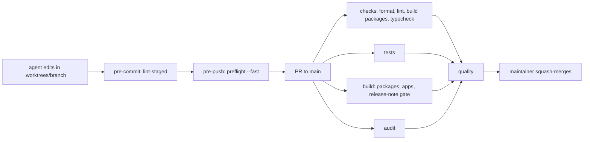

# ADR: AI governance for the Whisk repository

- **Status:** Proposed, awaiting maintainer approval
- **Date:** 2026-10-15
- **Scope:** repository process, CI, git hooks, contributor docs. No package source,
  public API, or published artifact changes.

## Context

Whisk is a public pnpm workspace (`packages/core`, `packages/react`, `apps/docs`,
`examples/*`) that moves USDC across chains. Agents now do a large share of the work,
and the v1 rebuild (direct CCTP V2, new `packages/cctp`, `apps/console`) is waiting to
land with known fund-safety defects found in review.

What exists on `main` today, verified on 2026-10-15:

- CI runs one job, "Type-check, test, build", plus "Dependency audit". Branch
  protection on `main` requires both, enforces admins, requires linear history, and
  allows squash and rebase merges.
- `.husky/pre-commit` runs lint-staged (Prettier). There is no pre-push hook.
- There is no format check in CI. `prettier --check .` fails only on
  `apps/docs/.source/`, which is generated by fumadocs-mdx and gitignored by
  `apps/docs/.gitignore`.
- There is no ESLint configuration anywhere. `pnpm lint` runs `tsc --noEmit` in
  `core` and `react`, `next lint` in the playground (which lints nothing without a
  config), and `next lint` in `apps/docs`, which fails because Next 16 removed it.
- Examples and apps resolve package types from `dist`, so typecheck needs the
  packages built first. Measured locally: packages build 8s, typecheck 6s, tests 2s,
  playground build 19s.
- There is no rulebook for agents, no ADR practice, and no release-note practice
  beyond changesets.

## Decision

1. Adopt the governance pattern from `AI-GOVERNANCE-SETUP.md`: `AGENTS.md` is the
   rulebook, `CLAUDE.md` is `@AGENTS.md`, and
   `.claude/skills/whisk-engineering-standards/SKILL.md` holds the craft rules.
2. Add a sixth directive: no AI-written comments anywhere in the project. Comments are
   written as a human would write them, and only when the code cannot say it.
3. `main` is the only long-lived branch. All work happens in `.worktrees/<branch>`
   off `origin/main`.
4. `scripts/preflight.sh` runs five gates: format check, lint, typecheck (after
   building the packages), tests, and the app build (`pnpm build:apps`, the
   playground today). `--fast` skips the app build.
5. `.husky/pre-push` runs `./scripts/preflight.sh --fast`. `pre-commit` keeps
   lint-staged.
6. Remove the two `next lint` scripts. They lint nothing today; keeping them would
   make the lint gate fail for a reason unrelated to code quality. `pnpm lint` then
   runs the `tsc` lint in `core` and `react`. Adopting ESLint, including a layering
   rule, is a separate ADR.
7. Ignore `apps/docs/.source/` and `.worktrees/` in Prettier. The first is generated
   output; the second holds other branches.
8. CI becomes four parallel jobs (`checks`, `tests`, `build`, `audit`) and one
   aggregating `quality` job. Node comes from a new `.nvmrc` (22).
9. `scripts/check_release_notes.sh` fails CI when `packages/`, `apps/` or `examples/`
   change without a note in `docs/release-notes/`. Changesets version PRs and
   Dependabot branches are exempt because a bot cannot write the note. Changesets stay
   the source of npm changelogs; release notes are the governance record.
10. The PR template merges the governance checklist with the existing fund-safety
    checklist and gains a changeset item.
11. The playground pins `outputFileTracingRoot` to its own checkout. Without it, a
    build inside `.worktrees/` picks the outer checkout as the workspace root because
    that checkout has its own lockfile.
12. The maintainer changes branch protection to require `quality` only and to allow
    squash merges only. The agent does not change repository settings.

## Diagram

## Consequences

- Every non-trivial change waits for a human decision. Slower to start, much harder
  to ship a fund-loss bug by accident.
- Pushing runs about 20 seconds of checks locally.
- Lint is weaker than the pattern assumes until the ESLint ADR lands; the gate exists
  so that change is a one-line swap.
- Only the playground is build-checked in CI, as today. Building the docs and the
  other examples is left for a follow-up so this change does not mix in new failures.
- The v1 rebuild must pass `format:check` and carry an ADR pair and release note when
  it lands.

## Alternatives considered

- Keep `next lint` and add ESLint configs now. Lost: it turns a process change into a
  code change touching every app, and Next 16 has no `next lint` to keep.
- Require a release note on bot PRs. Lost: the bot cannot write one, so every
  Dependabot PR would need a human commit just to pass the gate.
- Shard tests across two runners. Lost: the suite runs in 2 seconds.

## Verification

- `./scripts/preflight.sh` passes from a clean checkout of this branch.
- `git push` from this branch runs the fast preflight.
- The PR shows `checks`, `tests`, `build`, `audit` and `quality`, all green.
- After merge, branch protection requires `quality` and only squash merge is allowed.
