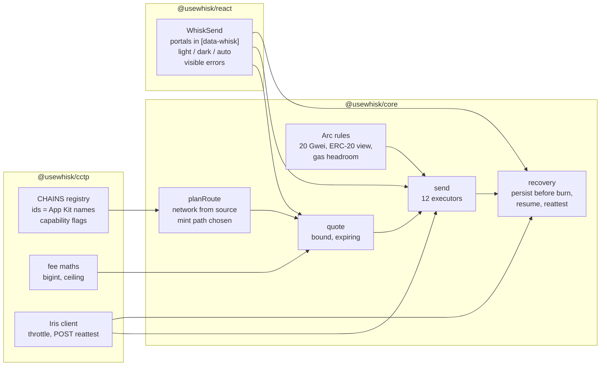
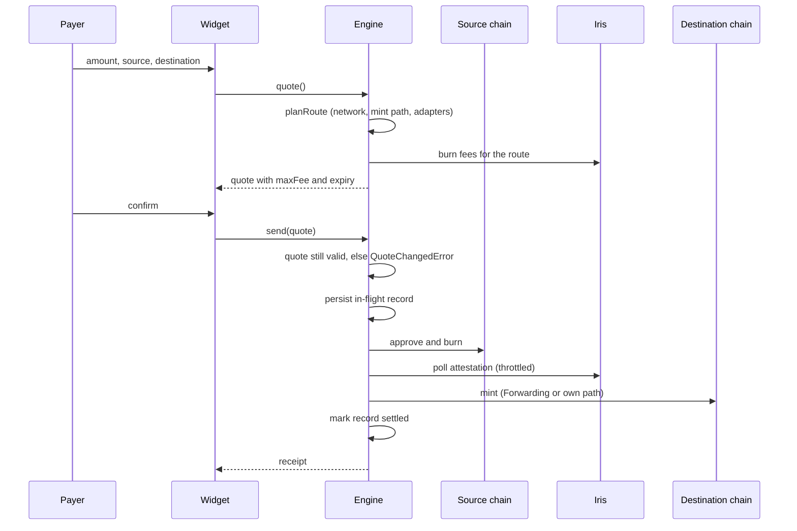

# ADR: Phase 1, Foundation

- **Status:** Proposed, awaiting maintainer approval
- **Date:** 2026-10-16
- **Scope:** `usewhisk/whisk` on branch `feat/v1-cctp-rebuild` (PR #57): `packages/cctp`,
  `packages/core`, `packages/react` and `examples/*`. `apps/console` and `apps/docs`
  leave this repo. No platform code, no new product surface, no hosted service.
  Parent decision: `ADR-2026-10-16-whisk-platform.md`, Decision 14, Phase 1.

## Context

Verified on 2026-10-16 against `feat/v1-cctp-rebuild` at `2add7d6`. Paths are relative
to the repo root.

### Published state

- npm has `@usewhisk/core` and `@usewhisk/react` up to `0.1.0`, built on Circle App Kit.
  `@usewhisk/cctp` has never been published.
- PR #57 replaces App Kit with a direct CCTP V2 integration. It is a breaking change for
  every `0.1.0` user.

### Defects confirmed in PR #57

Fund safety:

1. **Network comes from `config.mode`, not the source chain.**
   - `resolveMode` always returns a value (`core/src/engine/createWhisk.ts:91-94`).
   - That makes the fallback in `resolvedConfig.mode ?? source.network`
     (`createWhisk.ts:258`, `engine/quote.ts:108`) dead code.
   - The wrong network then reaches Iris host selection, fee lookup and all 12
     executors.
   - `inferMode` turns a mixed chain list into `"testnet"` (`core/src/chains/mode.ts:6-15`).
     An explicit mode beats the chains with only a `console.warn`.
2. **Solana to EVM with `useForwarder: false` burns, then fails.**
   - `executeSolanaToEvm.ts` submits the burn (:153), confirms it and polls Iris.
   - Only then does it return "Manual mint on EVM destination from a Solana source is
     not implemented" (:262-272).
   - The USDC is attested and never minted, and nothing upstream rejects the
     combination.
3. **Burn fees round down.**
   - `computeBurnFee` (`cctp/src/fees/math.ts:42-57`) computes
     `floor(amount * ceil(bps * 100) / 1e6)`, with float maths in the scaling step. Its
     doc claims the opposite.
   - `maxFee` can be one subunit short, and a Fast transfer then falls back to Standard
     or fails.
   - More float maths on money: `core/src/engine/quote.ts:87-90` (`parseFloat`) and
     `react/src/components/WhiskSend.tsx:613-616`.
4. **In-flight transfers have no recovery surface.**
   - `saveInflight` and `loadInflight` (`core/src/recovery/persistence.ts`) are exported
     and never called.
   - A tab closed after the burn loses the transfer from the widget.
5. **The executed transfer can differ from the quote the payer saw.**
   - `WhiskSend` passes `quote` to `engine.send` (:321).
   - `createWhisk.send` (:122-145) ignores it and fetches fees from Iris again.

Correctness:

6. Stellar (27) and Starknet (25) are missing from core's `DOMAIN_MAP`
   (`core/src/chains/cctpDomain.ts:7-46`). Recovery and receipts treat them as non-CCTP.
7. The address resolver (`core/src/resolvers/address.ts:6-13`) accepts only 40-hex EVM
   and base58 addresses. The widget therefore rejects every Stellar strkey and most
   Starknet felts, although `core/src/chains/registry.ts:23-26` has correct patterns.
8. `reattest` builds `POST /v2/reattest/{nonce}`, but `fetchIrisJson` hard-codes
   `GET` (`cctp/src/iris/fetch.ts:57-59`). Nothing in core calls it.
9. Arc is not in the cctp registry, yet `Arc_Testnet` is the `evm()` default
   (`react/src/config/adapters/evm.ts:347-351`) and leads three examples.
   - A same-chain Arc send throws `UnknownChainError` (`createWhisk.ts:199`).
   - `WhiskSend.handleSubmit` (:309-339) has no `catch`, so the payer sees nothing.
   - Core labels Arc's native symbol `ARC`; it is USDC.
10. Widget portals (`ChainPicker.tsx:45-59`, `ConnectModal.tsx:275-360`) render into
    `document.body`, outside `[data-whisk]`. Every rule in `styles.css` is scoped under
    `[data-whisk]`, so dialogs and selects lose all theme variables and styles.

Platform code inside this repo (`apps/console`):

11. `createAppAction` (`apps/console/src/app/dashboard/actions.ts:41-58`) checks org
    membership but not that `projectId` belongs to that org. Any user can mint keys in
    another tenant's project.
12. The new secret key is put in a redirect query string (`?reveal=`, :55-57).
13. `/v1/verify` prefers a body-supplied `origin` over the `Origin` header
    (`app/v1/verify/route.ts:37`). That bypasses the live allowlist.
14. The SDK trusts the handshake's unsigned JSON (`react/src/cloud/client.ts:72`) and
    never verifies the JWT. The tier bps (`TIER_BPS`, 15/10/5/0) are display-only and
    computed with `Number(...)`.

### Structure

- **Two registries.** Core's `Chain` union (`core/src/types/chain.ts`) has 43 App Kit
  names.
  - The cctp registry has 24 entries.
  - 19 chains exist only in core, including Arc. Naming differs (`Base_Sepolia` against
    `BaseSepolia`).
  - The bridge between them is a private `lookupCctpChain`, duplicated in
    `createWhisk.ts:761-779` and `quote.ts:135-153`.
- **viem.** Every package declares `viem ^2.23.0` as a dependency, not a peer. viem
  ships the `arc` chain from 2.49.3.
- **Tests.**
  - vitest 4. cctp has 10 test files, core 27, react 2, the console 0.
  - None of the 11 cross-ecosystem executors is imported by any test.
  - Engine tests mock `@usewhisk/cctp` wholesale.
- **Comments.**
  - cctp's comment-to-code ratio is 0.36. `chains/types.ts` is 118 of 212 lines
    comment.
  - About 48 banner lines and 339 comment lines with em-dashes, plus stale history
    ("arrive in S5").
  - All of these break Directive 6.

### External facts

From Arc and Circle docs, read 2026-10-16:

- Arc mainnet is chain `5042` and testnet `5042002`, both CCTP domain 26.
  - TokenMessengerV2: `0x28b5a0e9C621a5BadaA536219b3a228C8168cf5d` on mainnet,
    `0x8FE6B999Dc680CcFDD5Bf7EB0974218be2542DAA` on testnet.
  - MessageTransmitterV2: `0x81D40F21F12A8F0E3252Bccb954D722d4c464B64` on mainnet,
    `0xE737e5cEBEEBa77EFE34D4aa090756590b1CE275` on testnet.
  - USDC's ERC-20 view: `0x3600000000000000000000000000000000000000` on both.
- Arc rules:
  - A transaction with `maxFeePerGas` under 20 Gwei is silently dropped.
  - Gas is paid from the same USDC balance.
  - `-32014` near the head is safe to retry.
  - `eth_getLogs` is capped at 10,000 blocks.
- Iris allows about 35 requests per second and blocks for 5 minutes after a 429.
- Standard Transfer is free on every chain. Some sources (Avalanche, Polygon PoS, Sei,
  XDC and their testnets) have no Fast Transfer.

## Decision

### 1. One registry, owned by `@usewhisk/cctp`

1. The cctp registry is the only chain table. Core's `Chain` union, `DOMAIN_MAP`, the
   App-Kit-mirrored `core/src/chains/registry.ts` and both copies of `lookupCctpChain`
   are deleted.
2. Chain IDs are Circle's App Kit `Blockchain` strings (`Arc`, `Arc_Testnet`,
   `Base_Sepolia`, `World_Chain`). Developers moving from `0.1.0` or from App Kit keep
   the names they know. cctp entries are renamed to match.
3. `Chain` in core is derived from the registry (`(typeof CHAINS)[number]["id"]`), so a
   chain added once is typed everywhere.
4. Each entry carries:
   - id and label;
   - ecosystem and network;
   - CCTP domain and contract addresses;
   - native currency;
   - USDC decimals;
   - default RPCs and explorer;
   - capability flags taken from Circle's tables: `fastSource`,
     `forwardingDestination` and `upfrontFeeSource`.
5. Registry lookups stay throwing (`UnknownChainError`), and every public entry point
   resolves its chains before any wallet interaction.

### 2. Chain coverage for Phase 1

1. **Mainnet and testnet** for every CCTP domain that carries USDC:
   - Ethereum, Avalanche, OP, Arbitrum, Base, Polygon, Unichain, Linea, Codex, Sonic,
     World Chain, Monad, Sei, XDC, HyperEVM, Ink, Plume, Arc, EDGE, Injective, Morph,
     Pharos, Cronos, Plasma and X Layer;
   - Solana, Stellar and Starknet.
2. **Sources.** Standard-only chains are supported as sources with an honest ETA, rather
   than refused. Standard is free, and refusing it drops a large share of real payers.
3. **Verified addresses.** Every address comes from Circle's or Arc's published tables.
   A registry check script reads `localDomain()` from each EVM `MessageTransmitterV2`
   over public RPC and fails if it disagrees with the entry. It runs in a nightly
   workflow, not in `quality`, because it needs the network.
4. **Excluded:** BNB, Noble, Sui and Aptos, per the parent ADR.

### 3. Network comes from the source chain

1. `config.mode`, `resolveMode` and `inferMode` are removed from core and react.
2. A transfer's network is `source.network`.
3. A source and destination on different networks raise `NetworkMismatchError` before
   a quote is returned.
4. A widget config that lists chains from both networks is valid. The chain picker
   shows the destination options that match the selected source.
5. The default resolver picks ENS mainnet or Sepolia from the destination chain's
   network.

### 4. Every route is planned before anything is signed

1. A new `planRoute(source, destination, options)` returns either a fully executable
   plan or a typed `RouteUnavailableError`. It decides:
   - Fast or Standard;
   - Forwarding or Whisk mint path;
   - which adapters are required.
   `quote` and `send` both go through it.
2. A plan whose mint path needs a destination adapter fails at plan time when that
   adapter is not connected. The payer is asked to connect the destination wallet, or
   the plan uses Forwarding where it exists.
3. **Solana to EVM without Forwarding** mints with the connected EVM destination
   adapter through `receiveMessage`. When no EVM adapter is connected and Forwarding is
   off, planning fails before the burn.
4. **Bound quotes.**
   - `send` takes the quote the payer saw and checks that it is still valid. Quotes
     expire after a fixed window.
   - If a refreshed `maxFee` is higher, `send` returns `QuoteChangedError` for the UI to
     re-confirm instead of signing.

### 5. Exact money maths

1. Iris fee values are parsed from their decimal strings into integer
   hundredths-of-a-bp bigints, with no `Number` step.
2. `computeBurnFee` uses ceiling division: `(amount * fee + d - 1n) / d`.
3. The forwarder fee is parsed the same way.
4. `parseFloat` and `Number(...)` are removed from every money path, display included.
   Display formatting takes bigint subunits and decimals.
5. A lint rule forbids `parseFloat`, `Number(` and `toFixed(` in
   `packages/*/src/**/{fees,engine,quote}*`. The exact rule is chosen in the plan.

### 6. Recovery for every in-flight transfer

1. Before the burn is submitted, the engine persists an in-flight record: route, amount,
   source tx hash once known, nonce once known, and network. It updates the record at
   each step.
2. The widget reads in-flight records on mount and offers "Resume" for each one.
3. Every in-flight state links to a receipt URL that can resume the transfer from the
   source tx hash alone.
4. Re-attest uses `POST`. Core's recovery path calls it when an attestation has expired
   or is stuck.
5. The Iris client throttles below the documented limit. On a 429 it backs off for 5
   minutes and shows that state instead of retrying blindly.

### 7. Arc as the home chain

1. Arc mainnet and testnet are in the registry, with:
   - native currency `USDC` at 18 decimals;
   - USDC ERC-20 at `0x3600...0000` with 6 decimals.
2. The Arc adapter behaviour lives in one place in core:
   - balances and transfers through the ERC-20 view, shown as one row;
   - "max" holds back an estimated gas amount;
   - `maxFeePerGas` is clamped to at least 20 Gwei;
   - one confirmation is final;
   - `-32014` is retried with backoff;
   - `eth_getLogs` is paged under 10,000 blocks.
3. Arc is the default source and destination in examples and docs on both networks.
4. `viem` becomes a peer dependency `>=2.49.3 <3` in core and react, and a dependency
   of the same range in cctp. The local Arc chain object is replaced by viem's `arc`.

### 8. Widget fixes

1. All Radix portals render into a container inside `[data-whisk]`, provided by
   `WhiskProvider`.
2. Theme presets: `light` (default), `dark` and `auto` (`prefers-color-scheme`). The
   existing dark styles are kept and exposed as a preset.
3. **Errors are visible.**
   - Every async handler in the widget catches, maps the error to a typed Whisk error
     code and renders it.
   - An unhandled rejection in a widget test fails the test.
4. Recipient validation calls a resolver that understands every ecosystem: EVM, base58,
   Stellar G, M and C strkeys, and Starknet felts. It uses the registry's patterns.

### 9. Platform code leaves the SDK repo

1. `apps/console` moves to `usewhisk/platform` (platform issue #3) and is removed from
   PR #57.
   - Its defects (Context items 11 to 14) are fixed test-first during the port, before
     the console is deployed anywhere.
   - Nothing of it is deployed today.
2. `react/src/cloud`, the handshake client and the protocol-fee display are removed.
   Phase 2 brings back a handshake that verifies its token against JWKS. Until then the
   published packages need no app ID.
3. `apps/docs` moves to `usewhisk/docs` (docs issue #2). It is removed from this repo
   only once `docs.usewhisk.xyz` serves the ported content.

### 10. Tests that prove the routes

1. **Red then green** for every defect in Context items 1 to 10: a failing test first,
   naming the defect, then the fix.
2. **Route wiring tests.**
   - All 12 executors are exercised through `createWhisk().send`.
   - They use in-memory fake adapters per ecosystem and a fake Iris served over the
     real `fetch` interface, not a module mock of `@usewhisk/cctp`.
   - Each test asserts the burn arguments: domain, `mintRecipient`, `destinationCaller`,
     `maxFee` and hookData. It also asserts that nothing is burned when any pre-mint
     check fails.
3. **Stellar rule.** A dedicated test asserts that `mintRecipient` and
   `destinationCaller` equal `CctpForwarder` and that the real recipient is in hookData.
4. **Testnet matrix.**
   - `pnpm test:testnet` runs funded Arc Testnet to Base Sepolia, Base Sepolia to Arc
     Testnet, Ethereum Sepolia to Solana Devnet, Solana Devnet to Arc Testnet, Arc
     Testnet to Stellar Testnet, and Arc Testnet to Starknet Sepolia.
   - It runs nightly and on demand, never in `quality`.
5. **Mainnet smoke.** The maintainer runs one Arc to Base and one Base to Arc mainnet
   transfer of 1 USDC each before publish.

### 11. Directive 6 sweep

Every comment in `packages/*/src` and `examples/*` is rewritten or removed so the diff
meets Directive 6:

- no narration;
- no banners;
- no em-dashes;
- no stale history;
- no restated field names.

Comments that survive explain a protocol rule, such as the Stellar forwarder rule or
Arc's 20 Gwei floor.

### 12. Release

1. PR #57 merges once every `phase-1-foundation` issue in `usewhisk/whisk` (#61 to
   #75 and #86 to #93) is closed and preflight passes.
2. **Versions.** Changesets publish `@usewhisk/cctp@0.1.0` and
   `@usewhisk/core@0.2.0` / `@usewhisk/react@0.2.0`. The minor bump marks the break
   from the App Kit `0.1.0`.
3. **Provenance.** Publishing runs from GitHub Actions with npm provenance, never from
   a laptop.
4. **Migration.** A migration page covers `0.1.0` to `0.2.0`: chain IDs unchanged,
   `mode` removed, App Kit removed.

## Diagram

## Consequences

- **Harder:**
  - Removing `mode` is a breaking change for anyone on `0.1.0` who set it.
  - Supporting Standard-only sources means the widget must handle transfers that take
    13 to 19 minutes, so recovery has to be solid before publish.
  - Thirteen new chains each need verified addresses and a nightly check.
  - Removing the console from PR #57 delays any hosted feature to Phase 2.
- **Easier:**
  - One registry means a chain is added in one file.
  - Route planning means unsupported combinations fail before a signature, not after a
    burn.
  - Wiring tests on real routes make later phases safe to build on.
- **Accepted trade-off:** `0.2.0` ships with no app ID requirement. The app ID gate
  arrives with Phase 2, when there is a server to verify against.

## Alternatives considered

- **Keep `mode` as an override.** Lost: it is the root of defect 1. A setting that can
  make a mainnet burn poll the testnet Iris has no safe use.
- **cctp's own chain names (`BaseSepolia`).** Lost: App Kit names are what `0.1.0` users
  and Circle's docs use.
- **Refuse Standard-only sources, as today.** Lost: it drops Polygon, Avalanche, Sei and
  XDC payers for no fund-safety gain.
- **Keep `apps/console` in this repo and fix it here.** Lost: the parent ADR moves it to
  the private platform repo. Fixing it twice wastes the work, and it is not deployed.
- **Keep module mocks of `@usewhisk/cctp` in engine tests.** Lost: they are why 11
  executors have no coverage and why defects 2 and 5 were not caught.
- **Ship #57 first and fix after.** Lost: three of the defects can burn or misprice real
  money.

## Verification

- Each Phase 1 issue closes with its red test commit and green fix commit visible in
  the PR history.
- `./scripts/preflight.sh` passes in full on the final PR head.
- The route wiring suite covers all 12 executors. Every executor has a "check fails, no
  burn" case.
- The registry check script passes for every EVM entry on both networks.
- The testnet matrix in Decision 10.4 completes, and each transfer's receipt link
  resumes correctly after a forced tab close mid-attestation.
- In the playground, by hand:
  - a mixed mainnet and testnet config shows only matching destinations;
  - a Solana to EVM route with Forwarding off and no EVM wallet is refused before
    signing;
  - a dark site shows the `dark` preset with themed dialogs;
  - a Stellar G address and a Starknet felt are accepted as recipients.
- The maintainer's two 1 USDC mainnet transfers settle, and both show in their
  receipts.
