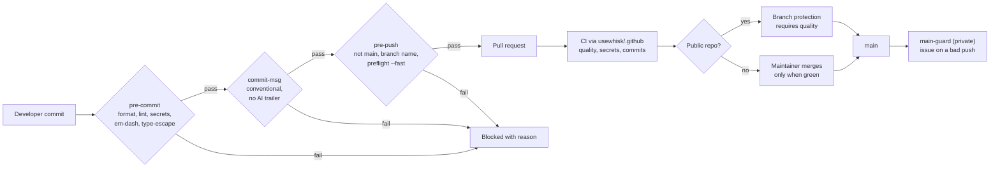

# ADR: Repository standards and local quality gates

- **Status:** Accepted by the maintainer on 2026-10-17
- **Date:** 2026-10-16
- **Scope:** every repository in the `usewhisk` org: `whisk`, `platform`, `docs`,
  `website` and `.github`. Developer tooling, CI and repository files only. No product
  code.

## Context

- The org is on GitHub's free plan. Verified 2026-10-16:
  - Branch protection works on the public repos (`whisk`, `docs`, `.github`).
    `whisk` already requires the `quality` check.
  - The same API call on `platform` returns "Upgrade to GitHub Pro or make this
    repository public to enable this feature". `website` is in the same position.
    Rulesets are not available either.
  - Nothing on GitHub can stop a direct push to `main`, or a merge with failing CI, on
    the two private repos.
- The maintainer will not pay for GitHub Team at this stage. They asked for husky or
  lefthook so that no bad code is pushed or merged.
- `whisk` already runs husky 9 with lint-staged.
  - `pre-commit` runs `prettier --write` on staged files.
  - `pre-push` runs `./scripts/preflight.sh --fast`.
  - Nothing blocks a push to `main`, a leaked secret, an AI attribution trailer or an
    em-dash.
- The new repos were created on 2026-10-16 with only a README. Their descriptions,
  topics, homepages, merge settings and security settings were applied the same day:
  - squash only, branch deleted on merge;
  - Dependabot alerts and security updates on;
  - secret scanning, push protection and private vulnerability reporting on the
    public repos.
- Tools available: gitleaks 8.30.1 (installed locally), lefthook 2.2.2 and commitlint
  21 on npm.

## Decision

### 1. Lefthook in every repo, replacing husky and lint-staged

1. Every repo installs `lefthook` as a dev dependency. Its `postinstall` installs the
   git hooks, so a fresh clone is protected after `pnpm install` with no extra step.
2. Lefthook is chosen over husky because:
   - it runs hook jobs in parallel;
   - it has built-in staged-file filtering and re-staging (`{staged_files}`,
     `stage_fixed`), which removes lint-staged;
   - one declarative `lefthook.yml` reads the same in every repo, whatever the stack;
   - it is a single native binary, so hooks stay fast in the larger repos.
3. `whisk` drops `husky`, `lint-staged` and `.husky/` in the same change.

### 2. The hooks

The canonical file lives at `usewhisk/.github/templates/lefthook.yml`. Each repo copies
it and changes only the commands for its own stack.

**`pre-commit`**, in parallel, on staged files only:

| Job | Blocks |
|---|---|
| `format` | Unformatted files. Runs `prettier --write` and re-stages the result |
| `lint` | ESLint errors on staged source files (repos with ESLint) |
| `secrets` | Any secret in the staged diff (`gitleaks git --staged --redact`) |
| `em-dash` | An em-dash in any added line (Directive 6) |
| `type-escape` | `@ts-ignore`, `@ts-nocheck` or `as any` in an added line (Directive 4) |

**`commit-msg`:**

| Job | Blocks |
|---|---|
| `conventional` | A header that is not a Conventional Commit (`commitlint` with `config-conventional`) |
| `no-ai-trailer` | `Co-Authored-By` lines naming an AI tool, and "Generated with" footers (Directive 6) |

**`pre-push`:**

| Job | Blocks |
|---|---|
| `protect-main` | Any push whose remote ref is `refs/heads/main`. This is the private repos' stand-in for branch protection |
| `branch-name` | Branch names outside `<type>/<kebab-description>`, where type is feat, fix, docs, chore, refactor, test, ci, perf or build |
| `preflight` | Anything that fails `./scripts/preflight.sh --fast`: format, lint, typecheck and tests |

Every hook job fails loudly with the reason and the fix. None of them is silenced or
softened (Directive 4).

### 3. CI is the backstop, in every repo

1. Hooks run on the developer's machine and can be skipped with `--no-verify`. CI
   catches anything that skips them.
2. **Shared workflows** live in `usewhisk/.github` and are called from each repo:
   - `quality.yml`: format, lint, typecheck, tests and build, ending in one job named
     `quality`;
   - `secrets.yml`: gitleaks over the PR range;
   - `commits.yml`: commitlint over the PR's commits and title.
   A public repo's reusable workflows can be called by the org's private repos, so
   there is one definition to maintain.
3. **gitleaks in CI** runs the released binary directly, not `gitleaks-action`, which
   requires a paid licence key for organisations.
4. **Public repos:** `quality` is a required status check, with strict up-to-date
   branches, linear history, conversation resolution and enforce admins. `whisk` has
   this today. `docs` and `.github` are protected now and get `quality` required as
   soon as their CI lands.
5. **Private repos**, where GitHub cannot enforce anything:
   - Merges happen only from the PR page with every check green. Only the maintainer
     merges.
   - A `main-guard` workflow runs on every push to `main`. If the push did not come
     from a merged PR, or `quality` fails on `main`, it opens an issue labelled
     `main-broken` and assigns the maintainer. A bad push cannot be prevented, but it
     cannot go unnoticed.
   - Moving to GitHub Team later only switches on branch protection. Nothing else
     changes.

### 4. Every repo carries the same standard files

| File | Contents |
|---|---|
| `README.md` | What it is, status, quickstart, project structure, links to docs, licence. Written for that repo's reader |
| `LICENSE` | MIT for `whisk`, `docs` and `.github`. A proprietary "all rights reserved" notice for `platform` and `website` |
| `AGENTS.md` and `CLAUDE.md` | The governance rulebook, adapted per stack |
| `CODEOWNERS` | `* @Signor1` |
| `.editorconfig`, `.nvmrc`, `.gitignore` | Shared defaults: Node 22, LF, 2 spaces |
| `.github/dependabot.yml` | npm and GitHub Actions, weekly, minor and patch grouped |
| `.github/workflows/ci.yml` | Calls the shared `quality`, `secrets` and `commits` workflows |
| `lefthook.yml`, `commitlint.config.js` | Decision 2 |
| `scripts/preflight.sh` | The same five gates, per stack |

These are org-wide defaults in `usewhisk/.github`, which GitHub applies to every repo
that does not have its own copy:

- `SECURITY.md`, `CONTRIBUTING.md`, `CODE_OF_CONDUCT.md` and `SUPPORT.md`;
- issue forms (bug, feature, chain request) and the PR template;
- the org profile at `profile/README.md`.

`whisk` keeps its own PR template and issue templates, which carry the governance
checklist.

### 5. Labels and settings

1. **Labels:** the same set in every repo.
   - Phase: `phase-1-foundation` to `phase-6-reach`, and `later`.
   - Type: `bug`, `feature`, `docs`, `chore`, `security`, `dependencies`.
   - Flags: `fund-safety`, `adr`, `main-broken`, `good first issue`.
   A script in `usewhisk/.github` applies them.
2. **Settings, already applied:** description, homepage, topics, wiki and projects off,
   squash merge only with the PR title and body, branch deleted on merge, Dependabot
   alerts and security updates on. Secret scanning, push protection and private
   vulnerability reporting are on for the public repos.

### 6. Rollout

Each repo gets one PR from a worktree, reviewed and merged by the maintainer:

1. `usewhisk/.github`: community files, profile, templates, shared workflows, the
   label script. It goes first, because the others call its workflows.
2. `usewhisk/whisk`: husky to lefthook, commitlint, the CI calls, `main-guard` is not
   needed (protected).
3. `usewhisk/docs`, `usewhisk/website` and `usewhisk/platform`: the standard
   scaffold. `platform` and `website` add `main-guard`.

## Diagram

## Consequences

- **Easier:**
  - Bad code, secrets, AI trailers and direct pushes to `main` are stopped before they
    leave the machine, at no cost.
  - Every repo looks and behaves the same, so moving between them is cheap.
  - One shared workflow definition means a gate is fixed once.
- **Harder:**
  - `pre-push` runs the fast preflight, which takes longer on big repos. That is the
    price of having no server-side gate.
  - Contributors need gitleaks installed. The hook fails with an install hint if it is
    missing, instead of skipping the check.
- **Accepted risk:** `--no-verify` and the web UI can bypass the hooks on the private
  repos. CI, the maintainer-only merge rule and `main-guard` make a bypass visible.
  They cannot make it impossible without a paid plan.

## Alternatives considered

- **Keep husky and add lint-staged everywhere.** Lost: two tools where lefthook is one.
  Hooks would run in series, and the configuration differs between stacks.
- **pre-commit (the Python framework).** Lost: it adds a Python dependency to an
  all-TypeScript org.
- **Make the private repos public to get branch protection.** Lost: the parent ADR
  keeps `platform` and `website` closed.
- **GitHub Team at $4 per user per month.** Deferred by the maintainer for cost. This
  ADR keeps the switch to it trivial.
- **`gitleaks-action` in CI.** Lost: it needs a paid licence for organisations. The
  binary does the same job for free.

## Verification

- In each repo, on a fresh clone, `pnpm install` installs the hooks. Each of these is
  then blocked with a clear message:
  - a commit containing a fake AWS key;
  - a commit adding an em-dash;
  - a commit adding `@ts-ignore`;
  - the commit message `fixed stuff`;
  - a message with a Claude co-author trailer;
  - `git push origin HEAD:main`;
  - a push from a branch named `wip`;
  - a push with a failing test.
- A clean `feat/x` branch with a conventional commit pushes, and its PR shows green
  `quality`, `secrets` and `commits` checks.
- On a private repo, a direct push to `main` made with `--no-verify` opens a
  `main-broken` issue within one workflow run.
- `gh repo view` for each repo shows its description, homepage, topics and licence.
  The org page shows the profile README.
