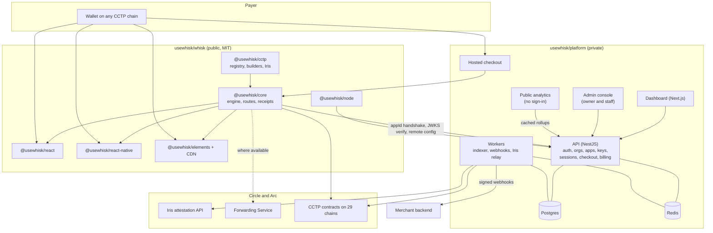
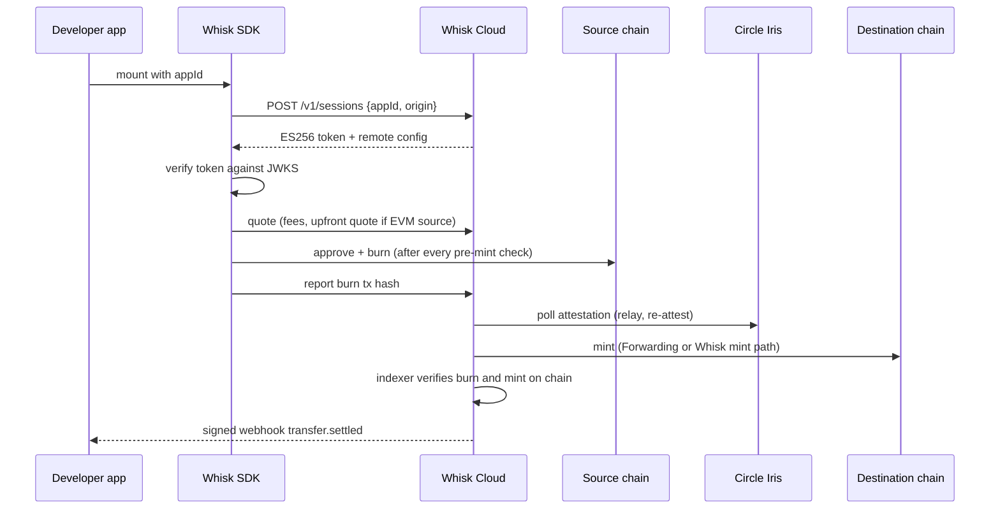

# ADR: Whisk as a production stablecoin payments platform

- **Status:** Accepted by the maintainer on 2026-10-16, with the modifications recorded
  in "Maintainer decisions"
- **Date:** 2026-10-16
- **Scope:** the whole product. SDK packages, a new hosted platform (API, dashboard,
  hosted checkout), docs, marketing site, repository layout across the `usewhisk` org,
  pricing. This is an umbrella decision: each phase in Decision 14 gets its own ADR
  pair before any code is written for it. No code changes with this ADR.

## Context

### What Whisk is today

Verified on 2026-10-16 against `main` (`99de19b`) and draft PR #57
(`feat/v1-cctp-rebuild`, `2add7d6`).

- `main` ships `@usewhisk/core` and `@usewhisk/react` on top of Circle App Kit. App Kit
  covers EVM chains and Solana only.
- PR #57 replaces App Kit with a direct CCTP V2 integration:
  - `@usewhisk/cctp`: protocol builders, the Iris client and fee math. 22 chain entries:
    11 networks, each with a mainnet and a testnet entry, across EVM, Solana, Stellar
    and Starknet.
  - `@usewhisk/core`: headless engine with 12 cross-ecosystem executors, receipts,
    refunds, webhook signing and theming tokens.
  - `@usewhisk/react`: the widget.
  - `apps/console`: Next.js, Better Auth, Drizzle and Postgres. It holds orgs,
    projects, apps, keys, and an ES256 JWT handshake published through JWKS.
- PR #57 has known defects from review that must be fixed before anything ships:
  - Network is taken from `config.mode` instead of the source chain.
  - Solana to EVM with `useForwarder: false` burns, then fails.
  - Stellar and Starknet are missing from core's domain table.
  - The address resolver rejects Stellar and Starknet addresses.
  - `reattest` uses GET; Circle documents `POST /v2/reattest/{nonce}`.
  - `computeBurnFee` rounding.
  - Console IDOR in `createAppAction`, and a secret key passed in a redirect URL.
  - Unstyled portals.
- PR #57 also has two architectural faults:
  - Two chain registries. Core keeps an App-Kit-mirrored union of about 48 chains;
    cctp has 22 entries.
  - Arc Testnet is the widget's first default chain, but cctp does not know Arc, so
    quote and send throw.
- The cloud handshake exists but enforces nothing:
  - The SDK never verifies the JWT.
  - Events are client-reported and never checked on chain.
  - Tier bps (15/10/5/0) are display-only.
  - Billing is a no-op.
- A few developers already use and like Whisk. There is no paid customer and no
  production SLA.

### What changed outside

Sources: Arc docs (`docs.arc.io`) and Circle docs (`developers.circle.com`), read
2026-10-16. Full notes are kept with the session research.

- **Arc mainnet is live:** public since 2026-09-16.
  - Chain ID `5042`; testnet `5042002`. CCTP and Gateway domain `26`.
  - USDC is the gas token. Native balance has 18 decimals; the ERC-20 interface at
    `0x3600...0000` has 6 decimals.
  - Sub-second deterministic finality (Malachite BFT).
  - Transactions with `maxFeePerGas` under 20 Gwei are silently dropped.
  - viem ships `arc` from 2.49.3. Whisk currently declares `^2.23.0`.
- **CCTP now has 31 domains:**
  - EVM: Ethereum 0, Avalanche 1, OP 2, Arbitrum 3, Base 6, Polygon 7, Unichain 10,
    Linea 11, Codex 12, Sonic 13, World Chain 14, Monad 15, Sei 16, BNB 17 (USYC only,
    no USDC), XDC 18, HyperEVM 19, Ink 21, Plume 22, Arc 26, EDGE 28, Injective 29,
    Morph 30, Pharos 31, Cronos 32, Plasma 33, X Layer 37.
  - Non-EVM: Solana 5, Sui 8, Aptos 9, Starknet 25, Stellar 27.
  - Every listed mainnet's official testnet is supported.
  - Noble (4) remains V1-only.
  - Sui and Aptos appear on the live V2 page, but Circle's own index header still says
    V1. Unverified.
- **CCTP V2 capabilities:**
  - Standard transfer is free. Fast costs 0 to 14 bps by source.
  - Re-attest is `POST`.
  - Iris rate limit is about 35 req/s, with a 5-minute block on 429.
  - The Forwarding Service mints on the destination for $0.05 plus gas, but is not
    available for Starknet, Stellar, Sui, Aptos and six EVM chains.
  - New upfront-fee quotes (`POST /v2/quote/burn/usdc/{src}/{dst}`) let the recipient
    receive an exact amount, from EVM sources only.
  - CCTP has no integrator fee; Whisk must collect its own.
- **Stellar:**
  - The burn must set `mintRecipient` and `destinationCaller` to `CctpForwarder`, with
    the real recipient in `hookData`. Getting this wrong loses funds permanently.
  - USDC has 7 decimals there against 6 in CCTP messages.
- **Arc App Kit (`@circle-fin/app-kit`):** absorbed Bridge Kit on 2026-03-17.
  - Covers 26 chains, EVM plus Solana. No Stellar, Starknet, Sui or Aptos.
  - Arc is the only chain with every capability: Send, Bridge, Swap, Unified Balance,
    Onramp, Earn and Borrow.
  - Kit keys are legacy and can no longer be created. Circle API keys are required for
    Onramp only.
  - Integrator fees split 90% to the integrator, 10% to Arc.
- **Arc Onramp** (`@circle-fin/onramp-kit`):
  - A hosted iframe or popup at `onramp.arc.io` that sells USDC or EURC on Arc.
  - Payment methods: debit card, Apple Pay and Google Pay (US, UK, select EU and
    others), and bank transfer (select US states and EU). No credit cards.
  - Needs a server-side Circle API key, Console KYB for card methods, a registered
    `referrerDomain`, a server session route (30-minute sessions) and webhooks as
    source of truth.
  - No offramp product exists from Circle.
- **Gateway (unified USDC balance):** 13 chains including Arc and Solana, not Stellar or
  Starknet. Fees are 0.5 bp plus gas, with under 500 ms spends after deposit.
- **Circle user-controlled wallets** (social, email and PIN; 2-of-2 MPC) have a React
  Native SDK. No Circle wallet supports Stellar, Starknet or Sui.
- **Compliance:** CCTP, Gateway and Onramp fall under Circle's permissionless product
  terms. The integrator owns licensing, sanctions screening and geo-controls, and may
  not use Circle marks without consent.

### What the market shows

From the Reown, Privy, Dynamic, thirdweb, Coinbase CDP, LI.FI, MoonPay and Stripe
research.

- **Reown's model:**
  - A public project ID, validated server side by the relay, with an origin and
    mobile-bundle allowlist.
  - Dashboard: teams, projects, members, usage and per-project remote feature toggles.
  - Pricing: free (1 project, 1 member, 500 signed-in MAU, hard cut-off), Pro at
    $89/mo (3 projects, 5 members), Growth at $350/mo.
  - Its 2025 move to a non-open-source "Community License" drew public pushback from
    wagmi.
- **What developers complain about:** hard cut-offs, paywalled live mode, MAU pricing
  for one-time payers, and license rug-pulls.
- **What works for payments widgets:**
  - A free integration.
  - An integrator-set fee with the platform taking a share (LI.FI, Socket, Arc App
    Kit).
  - Paid tiers for collaboration, reliability and compliance features.

## Decision

### 1. Who Whisk is for

Whisk is stablecoin payments infrastructure for developers. One integration lets an app
accept and send USDC across every CCTP chain, with Arc as the home settlement chain.

Primary users, in order:

1. Frontend and full-stack developers adding USDC payments to a product: indie
   developers, hackathon teams, startups.
2. Product teams at companies that need roles, environments, audit and reliability.
3. Businesses and brands that want payments without building UI: hosted checkout,
   payment links, a REST API and webhooks.

The end payer is a person with a wallet on any chain. Every surface is designed so that
payer never has to know what CCTP, a domain or an attestation is.

### 2. Product surfaces

All of these are built on one headless engine.

| Surface | Package or product | For |
|---|---|---|
| Protocol layer | `@usewhisk/cctp` | Advanced devs, other SDKs |
| Headless engine | `@usewhisk/core` | Any JS runtime, Vue, Svelte, server |
| React widget | `@usewhisk/react` | React and Next.js apps |
| React Native | `@usewhisk/react-native` | iOS and Android apps |
| Web component and script tag | `@usewhisk/elements`, plus a CDN build | Any site, WordPress, Webflow, Shopify theme |
| Hosted checkout and payment links | `pay.usewhisk.xyz` | No-code businesses, invoices, social sellers |
| Business REST API and Node SDK | `api.usewhisk.xyz`, `@usewhisk/node` | Backends, platforms, brands |
| Webhooks | Signed, retried, verified on chain | Order fulfilment |
| Dashboard | `dashboard.usewhisk.xyz` | Everyone above |
| Admin console | `admin.usewhisk.xyz` | The platform owner and Whisk staff only (Decision 15) |
| Public analytics | `stats.usewhisk.xyz` | Investors, partners, the community; no sign-in (Decision 16) |
| Docs | `docs.usewhisk.xyz` | Developers and agents |
| Website | `usewhisk.xyz` | Everyone |
| Status page | `status.usewhisk.xyz` | Everyone |

`usewhisk.xyz` is the platform domain. Every hosted surface lives on a subdomain of it.

Flutter, Swift and Kotlin are served first through hosted checkout and deep links.
Native SDKs come only when demand proves them.

### 3. Chain coverage

1. `@usewhisk/cctp` is the single chain registry. Core and react derive from it. The
   App-Kit-mirrored registry in core is deleted.
2. **Launch set**, mainnet and testnet: every CCTP domain that carries USDC.
   - EVM (26 chains): Ethereum, Avalanche, OP, Arbitrum, Base, Polygon, Unichain, Linea,
     Codex, Sonic, World Chain, Monad, Sei, XDC, HyperEVM, Ink, Plume, Arc, EDGE,
     Injective, Morph, Pharos, Cronos, Plasma, X Layer.
   - Non-EVM: Solana, Stellar, Starknet.
3. **Next set:** Sui and Aptos. Each is a new ecosystem adapter, added only after
   Circle's V2 contract addresses for it are confirmed on both networks.
4. **Excluded:** BNB (USYC only, no USDC through CCTP) and Noble (V1 only, being
   deprecated).
5. Each chain carries capability flags taken from Circle's tables, never assumed:
   - fast source;
   - Forwarding Service destination;
   - upfront fees;
   - further flags only when a capability that needs them is adopted.
6. Network (mainnet or testnet) is always derived from the source chain. Mixing
   networks in one transfer is rejected before any signature is requested.

### 4. Arc as the home chain

1. Arc mainnet and testnet are first-class. Arc is the default source and destination
   in examples, docs and the hosted checkout.
2. The Arc adapter handles the platform quirks in one place:
   - USDC balance and transfers read through the 6-decimal ERC-20 view, shown as one
     balance row;
   - "max" sends hold back gas;
   - `maxFeePerGas` is clamped to at least 20 Gwei;
   - fees display in USD;
   - one confirmation is final;
   - `-32014` is retried.
3. Invoice and order IDs attach on chain through Arc's Memo contract where the payer is
   an EOA.
4. The minimum viem version rises to the release that ships `arc` (2.49.3 or later).

### 5. How Whisk uses Circle's products

1. **Transfers:** CCTP V2 directly, through `@usewhisk/cctp`.
   - Forwarding Service is used where Circle offers it.
   - Whisk's own mint path is kept where it does not: Starknet, Stellar, Sui, Aptos and
     six EVM chains.
2. **Exact-amount payments:** where the source is EVM, the engine requests an
   upfront-fee quote so the recipient receives exactly the invoiced amount.
3. **Onramp: deferred, not dropped.** Arc Onramp will be built later under its own ADR
   pair, which also settles the KYB question (Whisk as one platform, or each developer
   bringing a Circle key). Nothing in this ADR's phases builds it. Two constraints keep
   the door open:
   - the engine models a payment as optional funding steps followed by a transfer, so
     "buy on Arc, then send anywhere" slots in without reworking the flow;
   - any future Circle API key and session route live in Whisk Cloud, never in the
     browser.
4. **Offramp:** an `OfframpProvider` interface only. The maintainer picks the provider
   later; no provider code is written under this ADR.
5. **Capability scope.** Whisk adopts a capability only when it helps a payment
   happen or helps a merchant run their money. The test is: does it move a payer from
   "I want to pay" to "the merchant has USDC"?

   | Capability | In Whisk | How | Why |
   |---|---|---|---|
   | Send (same chain) | Yes, launch | Own engine, all ecosystems | Core payment |
   | Bridge (cross chain) | Yes, launch | Own engine on CCTP, all ecosystems | Core payment; App Kit lacks Stellar, Starknet, Sui, Aptos |
   | Swap | Yes, Phase 4 | App Kit Swap, behind a `SwapProvider` interface, on the chains App Kit supports | "Pay with any token": payer holds ETH, SOL or USDT, merchant receives USDC. USDC and EURC on Arc for euro invoices |
   | Onramp | Later, own ADR | Arc Onramp behind `OnrampProvider` | Payers with no crypto pay by card or bank. Deferred by the maintainer until the KYB model is chosen |
   | Unified Balance | No, as a payer feature | None | A deposit-first balance adds a step before the first payment and covers 13 chains against CCTP's 29. It does not help a one-off payer |
   | Earn | Later, dashboard only | App Kit Earn | Yield on a merchant's idle USDC treasury. Never inside the payer widget |
   | Borrow | No | None | A credit product with liquidation risk. Not payments, and a different regulatory weight |
   | Offramp | Interface only | `OfframpProvider`, provider chosen by the maintainer | Merchants cash out to a bank |

   Each adopted capability is a plug-in module. The core widget never depends on App
   Kit or a Circle API key, and a capability that is off costs nothing in bundle size.
   Where App Kit routes an integrator fee, Arc takes 10%; the pricing in Decision 9
   accounts for it.
6. **Gateway and the agentic side.** Gateway, the network behind Unified Balance, is
   also the settlement rail for Circle Nanopayments: gas-free USDC payments down to
   $0.000001 that AI agents make over the x402 protocol (HTTP `402 Payment Required`),
   batched and settled on chain by Gateway. Arc lists this under its agentic economy,
   with a reference app (`circlefin/arc-nanopayments`). That is the one place Gateway
   would serve Whisk greatly: letting a merchant's API or content charge agents per
   request through the same app ID, dashboard and webhooks. Whisk does not adopt it
   now. A future agentic-payments ADR evaluates it, and nothing here blocks it:
   - remote config and the capability flags can switch it on per app;
   - the transfers module stores a payment method per record, not a CCTP-only shape;
   - docs ship `llms.txt` and an MCP server from day one (Decision 13), so agents can
     already integrate Whisk.7. **Payer wallets:** Circle user-controlled wallets (social, email and PIN login) are
   an optional module for payers with no wallet, on EVM and Solana, in Phase 6.

### 6. Whisk Cloud: the hosted platform

1. **Backend stack:**
   - NestJS on Node 22, in TypeScript, so request and response schemas are shared with
     the SDK.
   - PostgreSQL with Drizzle migrations; Redis for rate limits, idempotency and queues.
   - Background workers (BullMQ) for webhooks, on-chain verification and Iris polling.
   - OpenAPI generated from the Nest controllers, from which `@usewhisk/node` is
     generated.
2. **Modules:**
   - auth;
   - organizations and members;
   - projects and apps;
   - keys;
   - sessions (the SDK handshake);
   - transfers (the indexer and verification);
   - webhooks;
   - checkout (hosted pages and payment links);
   - billing;
   - audit log;
   - admin (Decision 15);
   - public stats (Decision 16).
3. **Hosting:** long-running containers for the API and workers, because the indexer
   and webhook retries need a persistent process. The provider is chosen in the
   Phase 2 ADR.
4. **Data:** Whisk Cloud is non-custodial. It never holds keys or funds, and stores only
   what a dashboard needs (addresses, hashes, amounts, metadata).

### 7. App IDs, keys and the handshake

1. **Credentials:**
   - Every app has a public `appId` per environment (test and live).
   - Allowed origins use Reown's format: exact `scheme://host:port`, whole-label
     wildcards, and localhost always allowed.
   - Mobile bundle IDs and package names for React Native.
2. **Server secret keys** (`wsk_sk_test_` and `wsk_sk_live_`):
   - shown once, stored as hashes;
   - scoped (read, write, checkout, webhooks);
   - rotatable with an overlap window, and revocable.
   - Secrets never travel in a URL.
3. **SDK handshake:**
   - The SDK exchanges `appId` and origin for a short-lived ES256 session token.
   - It verifies the token against the published JWKS and receives remote config:
     enabled chains, features, fee settings and branding.
   - Dashboard toggles change a live widget without a redeploy.
4. **What the app ID gates:** Whisk Cloud services.
   - hosted RPC;
   - the attestation relay, with retry and re-attest;
   - mint submission where Forwarding is unavailable;
   - receipts and recovery links;
   - webhooks;
   - analytics;
   - hosted checkout;
   - remote config.
   - The open-source protocol layer stays usable without Whisk Cloud, and the docs say
     so plainly. A gate on MIT code can be forked out, and pretending otherwise would
     erode trust. The default experience requires an `appId`, and the fast path to
     production runs through it.
5. **No app ID:** the widget renders a clear setup screen in development and refuses to
   start in production builds. Testnet app IDs are free and instant.

### 8. Authentication

1. **Dashboard sign-in** uses Better Auth, which the console already uses:
   - email magic link and passkeys;
   - Google, GitHub and Sign in with Ethereum;
   - TOTP two-factor;
   - session management with device list.
   - SAML and OIDC SSO is Enterprise only, later.
2. **Organization model:** org, then project, then app (test and live), then keys.
   - Roles: owner, admin, developer, viewer, billing.
   - Invites by email, and an audit log of every key, member, webhook and setting
     change.
3. **Payer identity:** Whisk does not force payers to log in, because that would hurt
   conversion.
   - Users are counted as unique paying wallets per app, verified on chain by the
     indexer, plus widget sessions.
   - Apps that want payer identity can turn on optional Sign in with X (SIWE, SIWS and
     the Stellar equivalent) per project.
4. **Verified metrics:** client-reported events are replaced by indexer-verified
   transfers. A transfer counts only when Whisk Cloud has seen the burn and the mint
   on chain.

### 9. Pricing and revenue

Adoption first. Live mode is never paywalled, and nobody hits a hard cut-off.

| Plan | Price | Who | Includes |
|---|---|---|---|
| Individual | Free | Solo developers | 1 seat; unlimited projects; test and live; every chain; widget, headless, React Native, elements; basic webhooks; 30-day analytics; Whisk badge; community support |
| Team | $29 per seat per month, 2 seat minimum | Teams | Roles and invites, audit log, hosted checkout on a custom domain, badge removal, 1-year analytics, more webhook endpoints, priority support |
| Business | From $499 per month | Brands, platforms | Business REST API volume tiers, SSO, uptime SLA, dedicated support, invoicing, data export |

Revenue alongside seats:

1. **Integrator fee share.** The SDK has an integrator fee: the developer sets a bps
   fee and a recipient, and the payer sees it before signing. Whisk keeps 10% of the
   integrator fee, mirroring Arc App Kit's 90/10. At launch Whisk's share is 0%, and it
   switches on only after a public announcement with notice. This turns revenue into a
   share of developers' success rather than a tax on them.
2. **No Whisk protocol fee on transfers at launch.** The display-only tier bps in the
   console are removed.
3. **Payment for plans:** Stripe Billing, and USDC paid through Whisk on Arc. Whisk is
   its own first customer.
4. Overages throttle and notify. They never cut a live checkout.

The maintainer accepted these prices and the 10% integrator fee share on 2026-10-16.
They are checked with the current developers before Phase 5 ships billing.

### 10. Open core, and the repositories in the `usewhisk` org

Whisk is open core. Everything a developer embeds or installs is open source under MIT,
and everything Whisk operates is closed. This is the model the business needs:

- Revenue comes from seats, the Business plan and the integrator fee share, all of
  which are hosted services. None of it depends on hiding the SDK.
- A developer can read every line that touches their payer's funds. For a payments
  SDK that is a trust requirement, and the external audit is public.
- The same split is standard for the products Whisk is compared with: Stripe's SDKs
  and Reown's earlier AppKit are open while the platforms behind them are closed.
- What a fork cannot copy is closed: the API, the indexer and verification, the relay
  and mint path, webhooks, the dashboard, admin, analytics, checkout and billing.
- Published packages never change licence. Reown's move from Apache 2.0 to a
  restrictive licence is the failure this rule prevents.

| Repo | Visibility | Contents |
|---|---|---|
| `usewhisk/whisk` | Public, MIT | SDK monorepo: cctp, core, react, react-native, elements, node, design tokens, examples |
| `usewhisk/platform` | Private | Whisk Cloud monorepo: `apps/api` (NestJS), `apps/workers`, `apps/dashboard` (Next.js), `apps/checkout` (hosted pages), `apps/admin` (owner console), `apps/stats` (public analytics), `packages/db`, `packages/contracts` (OpenAPI and shared schemas) |
| `usewhisk/docs` | Public | Mintlify docs, so the community can fix docs by PR |
| `usewhisk/website` | Private | Marketing site. Nothing in it is useful to fork, and keeping it private stops brand clones |
| `usewhisk/.github` | Public | Org profile, shared workflows, issue and PR templates, governance |

1. **Governance:** every repo carries `AGENTS.md`, preflight, the release-note gate and
   the `quality` check, adapted per stack.
2. **The contract between the SDK and the platform:** a versioned OpenAPI spec
   published by `platform` and consumed by `whisk` to generate `@usewhisk/node`.
3. `apps/console` moves out of `whisk` into `platform`. `apps/docs` moves to
   `usewhisk/docs`.

### 11. Design system

1. **Whisk's own surfaces are light-only:** website, docs, dashboard, admin, public
   analytics and hosted checkout. No dark theme is built or shipped for them.
2. **Direction, "the ledger":**
   - Type: Geist for UI, Geist Mono with tabular figures for every amount, address,
     hash and ID, and Instrument Serif italic for one word in marketing headlines only.
   - Colour: warm paper `#fbfaf7`, white surfaces, ink `#0b0b0c`, and one accent, Whisk
     Cobalt `#2b3cff`. Real state colours: settled green, in-flight amber, failed red.
   - Shape: hairline borders instead of shadows. Radius 0 on marketing and docs, 4px in
     the dashboard, a 6px default in the widget.
3. **Signature component:** the transfer trace, burn then attest then mint. The same
   component appears in the marketing hero, the widget progress view and the dashboard
   transfer detail. It respects reduced motion and never hides content behind
   scroll-reveal.
4. **Widget:** keeps generic theming for merchants. It ships `light`, `dark` and `auto`
   (follows `prefers-color-scheme`) presets, plus a small token set integrators can
   override, and it inherits the host font. The light-only rule covers Whisk's own
   surfaces, not the merchant's site. Hosted checkout stays light because it is Whisk's
   page, with the merchant's logo and accent colour.
5. Tokens live in one `@usewhisk/design-tokens` package consumed by every surface.

### 12. Security, safety and compliance

1. **Fund safety rules hold everywhere:**
   - no burn before every pre-mint check passes;
   - every in-flight transfer has a recovery link;
   - amounts are `bigint` subunits end to end.
2. **Before mainnet general availability:**
   - an external audit of `@usewhisk/cctp` and the core executors;
   - a public bug bounty;
   - a status page.
3. **Screening and the web perimeter:**
   - Sanctions screening on Whisk Cloud routes, using a screening provider chosen in
     the Phase 2 ADR.
   - Geo-controls where a capability requires them.
   - Rate limits per key and per app.
4. No Circle or Arc marks without Circle's consent. The SDK says "uses CCTP" in docs
   text only.

### 13. Docs and content

1. **Platform:** Mintlify at `docs.usewhisk.xyz`, from the public `usewhisk/docs` repo.
   It replaces Fumadocs because it gives Whisk, with no custom build:
   - an interactive API playground generated from the platform's OpenAPI spec, which
     stays in step with the API by construction;
   - an `llms.txt` file and a hosted MCP search server for every site, so coding agents
     can integrate Whisk from the docs (Decision 5.6);
   - the same reading experience as Circle's and Arc's docs, which Whisk developers
     already use;
   - light-only appearance with the toggle hidden (`"appearance": {"default":
     "light", "strict": true}`), themed with the ledger tokens.
   The trade-off is a hosted, paid dependency with less layout freedom than Fumadocs.
2. Docs, README files, the marketing site and examples are rewritten for the new
   surfaces:
   - every docs page opens with a working snippet;
   - units are explicit (6 decimals, 7 on Stellar, 18 for native Arc gas);
   - an error code catalogue;
   - a fund-safety page;
   - a live props playground beside each component reference.

### 14. Delivery phases

Each phase gets its own ADR pair, plan and approval before its code starts.

| Phase | Ships |
|---|---|
| 1. Foundation | Fix every PR #57 defect test-first. Single registry from cctp. Arc mainnet. All launch-set EVM chains. Merge #57. Publish `0.x` |
| 2. Platform | `usewhisk/platform`: NestJS API, auth, orgs, apps, keys, handshake, remote config, verified transfers, webhooks, dashboard, admin console, public analytics |
| 3. Distribution | `@usewhisk/react-native`, `@usewhisk/elements` and the CDN build, hosted checkout and payment links, Business API and `@usewhisk/node` |
| 4. Pay with anything | "Pay with any token" swap, the exact-amount upfront-fee flow, the offramp interface |
| 5. Revenue | Team and Business plans, billing, integrator fee share switch |
| 6. Reach | Sui and Aptos ecosystems, payer social wallets, merchant treasury Earn |
| Throughout | Design tokens, website, Mintlify docs, external audit before mainnet GA |
| Later, each with its own ADR | Arc Onramp and its KYB model; agentic payments (x402 Nanopayments on Gateway); the offramp provider |

### 15. Admin console for the platform owner

1. **What it is:** a separate app, `apps/admin` at `admin.usewhisk.xyz`, for the
   platform owner and Whisk staff. It is never reachable from the customer dashboard
   and shares no session with it.
2. **Access:**
   - platform roles held outside any customer org: `owner`, `staff` (support) and
     `analyst` (read-only);
   - passkey sign-in plus TOTP, short sessions, and an IP allowlist in front of the app;
   - every staff action lands in a platform audit log that staff cannot edit.
3. **What the owner sees and does:**
   - **Overview:** sign-ups, active apps, verified volume, transfers, unique paying
     wallets, settlement times, MRR and fee-share revenue;
   - **Customers:** every org, project, app, member and plan, with plan overrides,
     credits and trials;
   - **Transfers:** search by hash, address, app or nonce, and drive recovery for a
     stuck transfer (re-attest, re-submit the mint);
   - **Kill switches:** suspend an app or key, and pause a chain or a chain pair during
     a CCTP or chain incident, which every live widget picks up through remote config;
   - **Health:** Iris latency and rate-limit headroom, relayer gas balances per chain,
     webhook delivery rates, queue depth;
   - **Risk:** sanctions-screening hits and abuse flags;
   - **Feature flags:** global and per-app rollouts.
4. **Support access:** staff view a customer's dashboard read-only, only after giving
   a reason, and the customer can see that access in their own audit log. Staff never
   see secret keys, which are stored as hashes.

### 16. Public analytics

1. **What it is:** `stats.usewhisk.xyz`, a public page with no sign-in, in the spirit of
   a Dune dashboard. It is for investors, partners and the community, and doubles as
   marketing.
2. **What it shows:**
   - total and daily verified volume, transfers and unique paying wallets;
   - apps live on mainnet;
   - volume by chain and a chain-to-chain flow chart, with Arc's share;
   - settlement time at p50 and p95 by route;
   - growth over 7, 30 and 90 days and all time, with CSV download.
3. **What it never shows:** any customer's identity, app, revenue or wallet list.
   Figures are aggregates, and any bucket with too few transfers to stay anonymous is
   folded into "other". An app can opt in to a public "built with Whisk" showcase.
4. **Only verified numbers:** every figure comes from indexer-verified transfers
   (Decision 8.4), never client-reported events, so the page cannot be inflated by a
   noisy widget. Testnet is shown separately and never added to mainnet totals.
5. **Independently checkable:** the data is on chain, so Whisk also publishes a Dune
   dashboard over the same contracts and transfer markers. An investor does not have to
   trust Whisk's own page.
6. **Serving:** precomputed rollups behind a public, CDN-cached, rate-limited
   `GET /v1/public/stats`. The page never queries production tables directly.

## Diagram

## Consequences

- **Harder:**
  - Whisk becomes an operated service with uptime, on-call, secrets, an audit and a
    bug bounty. That cost is real and starts in Phase 2.
  - Four repos instead of one need cross-repo version discipline. The OpenAPI contract
    and changesets carry it.
  - Owning the mint path for Stellar, Starknet, Sui and Aptos means owning relayer
    gas and retries on those chains.
- **Easier:**
  - One registry and one engine serve every surface, so a chain added once appears
    everywhere.
  - Dashboard toggles change live widgets without redeploys.
  - Businesses can integrate with no frontend work at all.
- **Accepted trade-offs:**
  - Open core means the SDK can be read and forked. What makes Whisk worth paying for
    stays closed.
  - Mintlify is a hosted, paid dependency for docs.
  - Deferring onramp means payers with no crypto cannot pay at launch.
  - The app ID gate is a service gate, not DRM. Determined forks can run without Whisk
    Cloud, and the bet is that the hosted path is better.
  - Seats-only revenue is slow, so the integrator fee share is built from day one but
    switched on later.
  - Light-only own surfaces trade off users who prefer dark mode, for a sharper
    identity and half the design surface.
- **PR #57:** becomes Phase 1's base rather than being thrown away.

## Alternatives considered

- **Go back to Arc App Kit as the engine.** Lost: it covers 26 EVM and Solana chains
  only, and would drop Stellar and Starknet. Sui and Aptos would never come. Its fee
  share is 10% to Arc on every routed fee.
- **MAU pricing like Reown and Privy.** Lost: payers in a payment widget are often
  one-time. MAU punishes exactly the growth Whisk wants, and hard cut-offs are the top
  developer complaint.
- **A flat platform fee on every transfer** (Stripe's 1.5%, thirdweb's 30 bps). Lost:
  it taxes adoption from the first payment, and Circle's own Standard transfer is free.
- **Seats only.** Lost as the sole model: too little revenue from high-volume solo
  businesses. Kept as the Team plan.
- **Non-open-source license like Reown's Community License.** Lost: it cost Reown
  goodwill. MIT keeps contributors and trust; the moat is the hosted platform.
- **Everything closed source.** Lost: payers' funds pass through the SDK, and
  developers and auditors need to read it. Closing it would cost adoption and gain no
  revenue, because revenue comes from hosted services.
- **Everything open source, platform included.** Lost: it hands a competitor the
  indexer, relay, billing and admin, which are the paid product.
- **Unified Balance in the payer widget.** Lost: a deposit-first balance adds a step
  before the first payment and covers fewer chains than CCTP. Gateway is revisited only
  for agentic payments.
- **Keep Fumadocs.** Lost: a generated API playground, `llms.txt` and an MCP server
  would all be custom work there, and they come with Mintlify.
- **One monorepo for everything.** Lost: it mixes public MIT code with private platform
  code and secrets, slows SDK CI with backend builds, and blocks open-sourcing the docs.
- **Hono or Go for the backend.** Lost against NestJS: Hono lacks the module and
  dependency-injection structure a multi-domain platform needs. Go splits the type
  system from the SDK. NestJS keeps one language, generated OpenAPI and a large hiring
  pool.
- **Forcing payers to sign in to count users.** Lost: it adds a step to every payment.
  On-chain verified unique payers count users without friction.

## Verification

- **This ADR:** approved by the maintainer on 2026-10-16. Next, the Phase 1 ADR pair is
  drafted, and issues are filed per phase in the repos above.
- **Facts to re-check at the start of the phase that depends on them:**
  - Sui and Aptos V2 contract addresses;
  - Arc mainnet fee parameters and `GET /v2/burn/USDC/fees/26/{dest}`;
  - whether the Iris rate limit is 35 or 40 req/s;
  - the fee tier field name (`med` or `medium`).
- **Launch criteria** (Phase 5 exit):
  - A developer goes from sign-up to a settled mainnet transfer in under 10 minutes,
    measured with three outside developers.
  - Every launch-set chain pair has a scripted testnet transfer in CI or a nightly job.
  - The external audit has no open high or critical findings.
  - Webhook delivery succeeds at 99.9% with retries.

## Maintainer decisions (2026-10-16)

The maintainer approved this ADR with these modifications, all applied above:

1. **Unified Balance** is left out. Gateway returns only if it serves agentic payments
   (Decision 5.6).
2. **Pricing** and the 10% integrator fee share are accepted as proposed.
3. **Theming:** Whisk's own surfaces are light-only. The widget keeps light and dark
   themes for merchants (Decision 11.4).
4. **Onramp** is deferred to its own later ADR, together with the KYB question. It will
   be built (Decision 5.3).
5. **Docs** move to Mintlify (Decision 13).
6. **Domain:** `usewhisk.xyz` is the platform domain, with subdomains for every hosted
   surface (Decision 2).
7. **Admin console** for the platform owner (Decision 15).
8. **Public analytics** with no sign-in, for investors and others (Decision 16).
9. **Open source** is kept to a defined level: open core (Decision 10).
