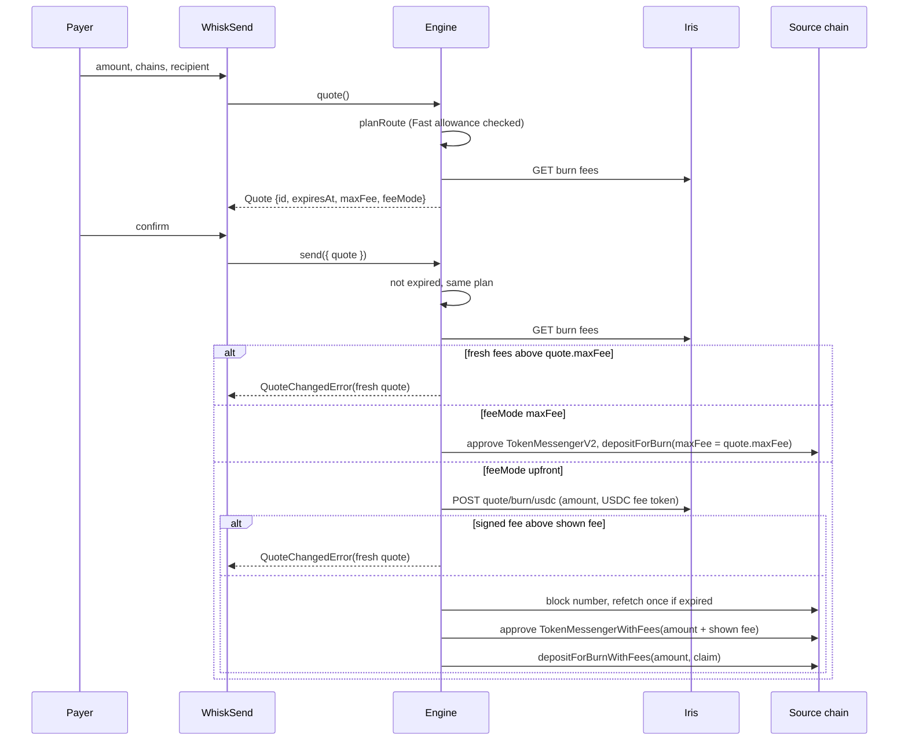

# ADR: Bound quotes and fees

- **Status:** Proposed, awaiting maintainer approval
- **Date:** 2026-10-18
- **Scope:** `packages/cctp`, `packages/core` and `packages/react` on
  `feat/v1-cctp-rebuild`. Phase 1 Step 6 (#87). Amends
  [ADR-2026-10-16-phase-1-foundation](ADR-2026-10-16-phase-1-foundation.md),
  Decision 4.4, and adds Circle's upfront fees, which that ADR did not cover.

## Context

Verified on 2026-10-18 against `feat/v1-cctp-rebuild` at `e7c9f9d`, Circle's docs and
live calls to Iris.

### What the code does today

- `createWhisk().send` takes the `Quote` the payer saw but never reads its fees. It
  calls `buildBridgeQuote` again (`core/src/engine/createWhisk.ts:259`) and burns
  with the fresh `maxFee`. The payer can sign a burn that differs from the screen
  (#87).
- `Quote` has no id, no expiry and no bigint fee fields. Amounts are display strings.
- `maxFee` is the Iris fee for the burn amount plus the forwarding fee at `med`, with
  no buffer.
- Whisk never calls `TokenMessengerV2.getMinFeeAmount`.

### How CCTP charges fees

- On a `depositForBurn`, `maxFee` is a cap. Circle takes the fee it executes,
  `feeExecuted`, at mint, and the recipient gets `amount - feeExecuted`.
- If `maxFee` is too low for Fast plus forwarding, Circle forwards the transfer but
  attests it as Standard. On Ethereum and the OP-stack chains that turns an 8 to 20
  second transfer into a 15 to 19 minute one, with no error.
- Circle spends the whole forwarding fee as destination gas and priority fee. It does
  not refund any of it.
- Live forwarding fees on mainnet, 2026-10-18 (USDC subunits):

  | Route | `med` | `high` | `high` minus `med` |
  |---|---|---|---|
  | Base to Arbitrum | 74,782 | 76,937 | 0.0022 USDC |
  | Ethereum to Base | 54,323 | 55,356 | 0.0010 USDC |
  | Base to Arc | 16,647 | 16,647 | 0 |
  | Base to Ethereum | 1,083,851 | 1,382,028 | 0.2982 USDC |

  `high` costs a fraction of a cent everywhere except into Ethereum, where it costs
  about 0.30 USDC more.

### Circle's upfront fees

- `POST /v2/quote/burn/usdc/{source}/{destination}` on the Iris host returns a signed
  quote for the Fast fee (`PRE_FINALITY`), the forwarding fee (`FORWARD`), or both.
  The payer submits it to `TokenMessengerWithFees.depositForBurnWithFees`. The
  contract collects the fee separately, and the recipient gets the whole burn amount.
- **No API key.** Unauthenticated requests to the sandbox and mainnet hosts both
  returned 200 with a signed quote.
- **No extra cut.** A mainnet quote for 1,000 USDC Base to Arbitrum priced
  `PRE_FINALITY` at 130,000 subunits (exactly Iris's 1.3 bps) and `FORWARD` at 74,782
  (exactly Iris's `med`).
- **Circle carries the gas risk.** Circle honours a signed quote even if fees rise,
  provided it is submitted before expiry.
- **Expiry and binding:**
  - A quote expires after about 2 minutes (2.5 on Ethereum), stated as a source block
    number or a wall-clock time.
  - It is bound to `amount`, `destinationDomain`, `burnToken`, `destinationCaller` and
    hook data. A burn that differs from any of them reverts, which costs gas but no
    USDC.
- **No refunds.** The fee can be paid in USDC or the native gas token, and upfront
  fees are not refunded. `refundAddress` is reserved.
- **Where it runs.** `TokenMessengerWithFees` is at
  `0x71f54F818671cD0D7ea140Da213e5C8b5C92a408` on 18 mainnet chains and
  `0x8745D906D67C346E5eb1aEEED38Eb87F34DF0C0A` on 17 testnets (not Monad testnet).
  Those are the chains the registry already flags `upfrontFeeSource`. Every other
  source, including Solana, Stellar and Starknet, has no upfront path.

### `getMinFeeAmount`

- Only a `TokenMessengerV2` with Circle's Standard fee switch has `getMinFeeAmount`.
  Today that is Sei.
- On every other chain the call reverts. Today every chain's Standard fee is 0.

## Decision

### 1. A quote is what the payer signs

1. `Quote` gains:
   - `id`, `issuedAt` and `expiresAt`;
   - the bigint fields `amountIn`, `burnAmount`, `burnFee`, `forwarderFee`, `maxFee`
     and `amountOut`;
   - `feeMode: "maxFee" | "upfront"`.

   The display strings stay, derived from the bigints. A refreshed quote is a new
   object with a new `id`.
2. A quote expires 60 seconds after it is issued. `WhiskSend` re-quotes before then
   while the form is open.
3. `send({ quote, adapter, destinationAdapter?, metadata? })` reads the chains,
   amount and recipient from the quote. The duplicated `QuoteParams` fields leave
   `SendParams`.
4. `send` runs these checks before any signature, in this order:
   1. the quote has not expired, else `QuoteExpiredError` (`quote_expired`);
   2. `planRoute` still gives the same plan;
   3. fresh Iris fees still fit under `quote.maxFee`. If they do not, `send` throws
      `QuoteChangedError` (`quote_changed`) carrying a fresh quote, and the widget
      shows the re-confirm view.
5. The burn uses `quote.maxFee` and `quote.burnAmount` exactly. Nothing between the
   screen and the signature recomputes them.

### 2. `maxFee` with a buffer, on every source

1. On Fast routes, `maxFee = ceil(burnFee * 1.2) + forwarderFee`. Circle takes only
   `feeExecuted`. The 20% stops a small fee rise from silently turning a Fast
   transfer into a Standard one.
2. `amountOut` is the minimum the recipient gets. With `feeBearer: "sender"`, any
   buffer Circle does not take reaches the recipient, so the payer loses nothing. The
   widget labels it "at least".
3. The forwarding fee level defaults to `high`, except into Ethereum, where it is
   `med`:
   - Into every other destination `high` costs under a cent more and protects the
     mint against a gas rise.
   - Into Ethereum it costs about 0.30 USDC more, all of it spent as gas.

   `createWhisk({ forwarderFeeLevel: "med" | "high" })` overrides both. The
   forwarding fee keeps its own line in the quote.
4. On Standard routes from a chain flagged `standardFeeSwitch`, the protocol fee is
   the larger of Iris's Standard fee and `getMinFeeAmount(burnAmount)`, read on chain
   at quote time.
   - The flag is new in the registry, set on Sei only.
   - `check:registry` checks it nightly. On every EVM chain, the flag must be true
     exactly when the call succeeds.

### 3. Signed quotes on upfront chains

1. `@usewhisk/cctp` gains:
   - `getSignedBurnQuote(network, source, destination, { amount, feeToken, requests,
     fetch })`, validated at the boundary and mapped to bigints;
   - the `TokenMessengerWithFees` ABI and a `tokenMessengerWithFees` address on each
     `upfrontFeeSource` registry entry, read back by `check:registry`;
   - `buildBurnWithFeesIntent`.
2. **When the upfront path is used.** All of these must hold:
   - the source is `upfrontFeeSource`;
   - `feeBearer` is `"sender"` (the default);
   - the transfer has a fee to pay: it is Fast, or Circle forwards it, or both.

   Otherwise the transfer takes the `maxFee` path. Receiver-pays stays on `maxFee`
   because an upfront fee is charged to the sender by design.
3. **Fee token.** Whisk pays the fee in USDC, so one approval covers the burn and the
   fee and every amount stays in USDC subunits. Paying in the native gas token would
   need a price conversion Whisk does not do.
4. **What the payer sees.**
   - The quote's fee is the Iris estimate at the levels in Decision 2. That shown fee
     is the most the payer pays.
   - The recipient gets exactly `amount`.
   - The approval is for `amount + shown fee`.
5. **When the signed quote is fetched.** At send time, after the checks in Decision
   1.4 pass, and never at display time, because it expires in 2 minutes.
   - If the signed fee is above the shown fee, `send` throws `QuoteChangedError`.
   - Otherwise the payer pays the signed fee, which is at or below the shown fee.
6. **Before the burn is submitted.** The engine reads the source block number. If the
   signed quote has expired, it fetches a new one and re-checks it, once, before
   refusing.
7. `depositForBurnWithFees` builds the default `cctp-forward` hook itself. Whisk
   passes no custom hook data, and `refundAddress` is the payer.
8. **Fast allowance.** On a Fast route the engine reads
   `/v2/fastBurn/USDC/allowance`. If the amount exceeds it, the route is planned as
   Standard, with the Standard ETA, before quoting. A Fast fee is never paid upfront
   for a transfer Circle will attest as Standard.

### 4. Split into two PRs

1. **6a: bound quotes and the buffer.** Decisions 1 and 2 (#87). The `getMinFeeAmount`
   read and the `standardFeeSwitch` flag land here.
2. **6b: signed quotes.** Decision 3, behind its own red tests.
   - It merges only after a testnet transfer from Base Sepolia and from Arc Testnet
     settles with the exact amount.
   - It also needs an answer on what a `PRE_FINALITY` quote does when the Fast
     allowance runs out between quote and attestation.

## Diagram

## Consequences

- **Harder:**
  - `SendParams` changes shape, which breaks callers that pass chains and amount to
    `send`. That is acceptable inside the `0.2.0` break.
  - The EVM executor has two burn paths and two spenders, both covered by the wiring
    suite.
  - Upfront fees depend on a second Iris endpoint. If it fails, `send` fails before
    any signature. It does not fall back to `maxFee` on its own, because the payer
    confirmed a different fee shape.
- **Easier:**
  - What the payer signs is what they saw, or they are asked again.
  - On 18 chains the recipient gets the exact amount, and Circle carries the gas risk
    on forwarding.
  - A short Fast fee no longer becomes a silent 15-minute wait.
- **Accepted trade-offs:**
  - On the `maxFee` path the payer funds a buffer that, when Circle does not take
    it, goes to the recipient rather than back to the payer.
  - Upfront fees are not refunded.

## Alternatives considered

- **Burn with whatever `send` re-fetches (today).** Lost: it is #87. The payer signs
  a fee they never saw.
- **`maxFee` only, no signed quotes.** Lost: it keeps the gas risk on the payer's
  forwarding fee and gives an inexact amount on the chains where Circle offers an
  exact one.
- **Signed quotes only.** Lost: Solana, Stellar, Starknet and nine EVM sources have no
  `TokenMessengerWithFees`.
- **Fetch the signed quote at display time.** Lost: it expires in 2 minutes, and a
  payer reading the form would see it lapse.
- **Pay the upfront fee in the native gas token.** Lost: Whisk keeps money in USDC
  subunits and has no price feed.
- **`high` into Ethereum as well.** Lost: about 0.30 USDC extra per transfer, all of
  it spent as gas.
- **Call `getMinFeeAmount` everywhere and treat a revert as zero.** Lost: it hides
  real failures (Directive 4). A registry flag checked nightly says which chains have
  the function.

## Verification

- **Red tests first.** `send(quote)` must burn with exactly `quote.maxFee` and
  `quote.burnAmount` (#87). An expired quote throws before any call. A fee rise past
  the buffer throws `QuoteChangedError` with zero burns.
- **Fast buffer.** A Base to Arbitrum Fast quote has
  `maxFee = ceil(burnFee * 1.2) + forwardFee.high`. Base to Ethereum uses `med`.
- **Sei.** A Sei Standard quote reads `getMinFeeAmount`. Every other chain does not,
  and `check:registry` fails if the flag is wrong.
- **Upfront path (6b).**
  - A harness Base to Arc send calls `depositForBurnWithFees` with the signed quote,
    and approves `TokenMessengerWithFees` for `amount + shown fee`.
  - A signed fee above the shown fee throws `QuoteChangedError` with zero burns.
  - An expired signed quote is fetched again once.
- **By hand, on testnet.** Base Sepolia to Arc Testnet and Arc Testnet to Base Sepolia
  through the playground. The recipient gets exactly the sent amount, and the fee
  shows as its own line.
- **Preflight.** `./scripts/preflight.sh` passes in full on each PR.
