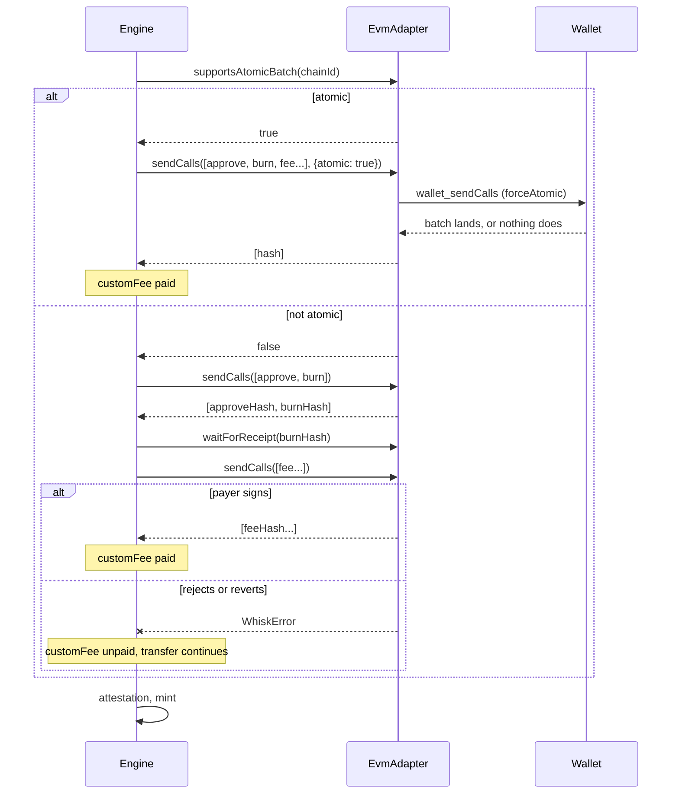

# ADR: Merchant fee after the burn

- **Status:** Accepted (2026-10-25)
- **Date:** 2026-10-25
- **Scope:** `@usewhisk/core` (EVM bridge executors, same-chain send, `EvmAdapter`,
  `SendResult`), `@usewhisk/react` (`createWagmiEvmAdapter`, `<WhiskSend>` result
  panel). `@usewhisk/cctp` does not change. Solana, Stellar and Starknet sources do not
  change: the custom fee is only charged on EVM sources today.

## Context

A merchant's `feePolicy` charges the payer a USDC fee on top of the amount, split
90/10 between the merchant and the Whisk treasury (`engine/customFee.ts`). Each share
is an ERC-20 `transfer` from the payer's wallet.

Every EVM executor sends `[...customFeeCalls, ...burnCalls]` in one `sendCalls`, and
`send/sameChain.ts` sends `[...customFeeCalls, transferCall]`
(`bridge/execute.ts:113`, `executeEvmToSolana.ts:144`, `executeEvmToStellar.ts:152`,
`executeEvmToStarknet.ts:120`, `send/sameChain.ts:54`). The reference adapter,
`createWagmiEvmAdapter`, sends the calls one by one and waits for each receipt before
the next (`react/src/hooks/useEvmAdapter.ts:52`). It never uses EIP-5792, although
the `EvmAdapter` docs say atomic batching is preferred.

So the fee lands first. If the payer then rejects the approve or the burn, or either
reverts, the payer has paid the merchant fee for a transfer that never happened, and
nothing refunds it (#163).

Simply moving the fee to the end of the same `sendCalls` is not safe either. With a
sequential adapter, a payer who rejects the fee prompt makes `sendCalls` throw after
the burn has landed. Every executor treats a throw from `sendCalls` as "the burn was
not submitted" and returns a failure without the burn hash in the recovery snapshot.
That loses track of a real burn, which is worse than the bug being fixed.

What the toolchain offers, checked against the installed versions:

- viem 2.57 `sendCalls` takes `forceAtomic: true`, and `getCapabilities` reports
  `atomic.status` per chain as `supported`, `ready` (the wallet can upgrade the
  account, as with EIP-7702) or `unsupported`.
- `@wagmi/core` 2.22 wraps both, plus `waitForCallsStatus`, which returns the receipts
  of a batch.

## Decision

1. **The fee is never sent before the money moves.** No executor sends a fee call
   ahead of the approve, the burn or the same-chain transfer.

2. **Atomic when the wallet can.** `EvmAdapter` gains an optional
   `supportsAtomicBatch?(chainId): Promise<boolean>`. When it returns `true` and there
   is a fee, the engine sends `[...burnCalls, ...feeCalls]` (or
   `[transferCall, ...feeCalls]`) in one `sendCalls` with a new option
   `{ atomic: true }`. An adapter given `atomic: true` must land all the calls or
   none, and must throw `WalletCapabilityError("atomic_unsupported")` without sending
   anything when it cannot. The batch shares one hash, as EIP-5792 batches already do.

3. **Fee as its own step otherwise.** Without atomic support, or without
   `supportsAtomicBatch`, the engine sends the burn calls alone, exactly as it does
   with no fee today. Once the burn's receipt is a success, it sends each fee share in
   its own `sendCalls`, before the attestation wait, while the payer is still looking
   at the wallet. One request per share means a payer who stops after the merchant
   share leaves an exact record of what landed. A rejected or reverted fee does not
   fail the transfer: the burn has happened and the mint goes ahead. An adapter that
   answers `atomic: true` with `atomic_unsupported` gets this path too.

4. **The result says whether the fee was paid.** `SendSuccess` and `SendFailure` gain
   an optional `customFee`, present whenever a fee policy applied:

   ```ts
   type CustomFeeOutcome =
     | { status: "paid"; txHashes: `0x${string}`[]; amount: string }
     | {
         status: "unpaid";
         amount: string;
         error?: WhiskError;
         txHashes?: `0x${string}`[];
       };
   ```

   `unpaid` with no `error` means the money never moved, so the fee was never asked
   for. `txHashes` on `unpaid` lists the shares that landed before the payer stopped.
   A merchant who fulfils orders from `onSuccess` can check `customFee.status`.

5. **The reference adapter implements both.** `createWagmiEvmAdapter` reads
   `getCapabilities` for the chain: `supported` or `ready` is `true`. With
   `atomic: true` it calls `sendCalls` with `forceAtomic: true`, reports the batch id
   through `onSubmitted` only once it has a transaction hash, and waits with
   `waitForCallsStatus`. Without `atomic`, it keeps today's one-by-one behaviour. A
   wallet whose `getCapabilities` fails has no EIP-5792 and counts as `false`. Calls
   that carry their own gas price, as on Arc, are refused as `atomic_unsupported`
   before anything is sent, since a batch cannot carry one.

6. **`<WhiskSend>` shows an unpaid fee.** The result panel says the transfer went
   through but the fee was not paid, with the reason when there is one.

7. **Resume does not ask for the fee.** A transfer resumed from its record after a
   reload between the burn and the fee prompt finishes with `customFee` `unpaid`. The
   inflight record stores the fee amount so the result can say so.

## Diagram



## Consequences

- **Payers can no longer lose the fee** to a rejected or reverted burn, on any wallet.
- **On a wallet without atomic batches, a payer can skip the fee** by rejecting its
  prompt after the burn. The merchant and the Whisk treasury lose that fee. The
  result reports it, so the merchant can decide whether to fulfil.
- **Wallets with atomic batches get one prompt instead of three or four,** which is
  the common case for smart accounts and wallets that support EIP-7702.
- `EvmAdapter` grows by one optional method and one option, so existing custom
  adapters keep compiling and get the fee-after-burn behaviour.
- Every EVM executor changes in the same way, so the change is shared in one helper
  rather than copied five times.

## Alternatives considered

- **Fee last in the same `sendCalls`.** Loses the burn hash when the payer rejects the
  fee on a sequential adapter (see Context). Rejected.
- **Refuse fee-bearing transfers on wallets without atomic batches.** No skipped fees,
  but many payers could not pay at all. Kept as a possible opt-in (`feePolicy`
  `requireAtomic`), not built now. See the open question.
- **Take the fee out of the burn with a CCTP hook contract.** Fixes skipping for good,
  but needs an audited contract per chain. Out of scope for 0.x.
- **Fee first, refunded on failure.** The refund would come from the merchant's
  wallet, which Whisk does not control. Rejected.

## Open question for the maintainer

Should a merchant be able to set `feePolicy.requireAtomic: true`, refusing the quote
on wallets without atomic batches instead of risking a skipped fee? The proposal
ships without it. It is a small addition later if merchants ask.

## Verification

- Wiring tests through `createWhisk().send` for Base to Arbitrum (forwarded), Base to
  Solana, Base to Stellar, Base to Starknet and a same-chain Base send, each with a fee
  policy:
  - burn rejected: no fee transfer was sent (the red test for #163);
  - burn reverts: no fee transfer was sent;
  - fee rejected after the burn: the transfer succeeds, `customFee` is `unpaid` with
    the error, the burn hash is in the result;
  - fee paid: `customFee` is `paid` with its hashes;
  - atomic wallet: one `sendCalls` with `atomic: true`, burn last before the fees.
- `createWagmiEvmAdapter` tests: capability mapping, `forceAtomic` passed, the batch
  receipt read through `waitForCallsStatus`.
- Testnet by hand: Base Sepolia to Arc Testnet with a fee policy, once with a
  sequential wallet (reject the fee prompt) and once with an EIP-5792 wallet.
