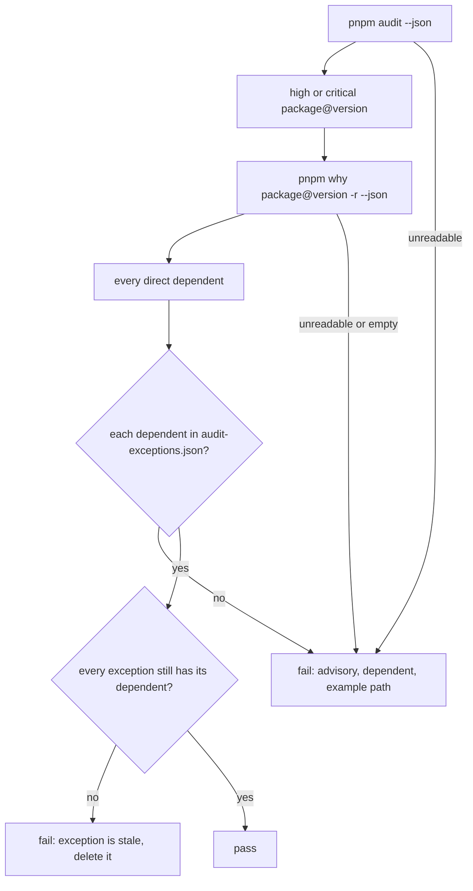

# ADR: Audit exceptions by dependent

- **Status:** Accepted (2026-10-26)
- **Date:** 2026-10-26
- **Amends:** `ADR-2026-10-26-scoped-audit-exceptions.md` (decisions 2 to 4)
- **Scope:** `scripts/audit.mjs`, its tests and `audit-exceptions.json`. No published
  package changes.

## Context

The scoped-exceptions gate matches each exception to one dependency path from
`pnpm audit --json`. pnpm prints only one path per vulnerable version, and which one
it prints depends on lockfile order.

Merging main into #176 regenerated the lockfile. pnpm then printed
`packages__react>viem>abitype>zod` for zod 3.25.76 instead of the `@coinbase/cdp-sdk`
path. The gate failed twice: the abitype path was "not covered" and the cdp-sdk
exception was "stale". Neither was true. Both paths were already on main.

`pnpm why <package>@<version> -r --json` lists every path. On main it shows:

| Version | Direct dependents (packages that link it)                     | Paths |
| ------- | ------------------------------------------------------------- | ----- |
| zod 3.22.4    | `@reown/appkit-wallet`, `abitype`                        | 80    |
| zod 3.25.76   | `@coinbase/cdp-sdk`, `abitype`                           | 32    |
| bigint-buffer 1.1.5 | `@solana/buffer-layout-utils`                      | 38    |

With #176 merged, zod 3.25.76 has 82 paths, through the same two dependents.

This exposes two flaws in path matching:

1. **It can pass wrongly.** An uncovered path hides behind an accepted path at the
   same version whenever pnpm prints the accepted one. If `@usewhisk/core` started
   depending on zod 3.25.76, the gate could stay green.
2. **It fails on noise.** Lockfile regeneration changes which path is printed, so
   ordinary dependency PRs fail with false "not covered" and "stale" messages.

Listing all 150 to 200 paths would fix flaw 1 but make flaw 2 worse. Every wagmi or viem
bump would rewrite dozens of entries, and reviewers would stop reading them.

The risk lives in the package that loads the vulnerable code, not in the route to
it. So the exception should name that package.

abitype is new to the list. It declares zod as an optional peer and uses it only in
its `abitype/zod` entry. The only installed package that imports `abitype/zod` is
`@coinbase/cdp-sdk`, which is already accepted. viem never loads it.

## Decision

1. **Every path, from pnpm itself.** The gate still takes the advisories and
   vulnerable versions from `pnpm audit --json`. For each high or critical
   `(package, version)`, it runs `pnpm why <package>@<version> -r --json` and
   collects every **direct dependent**: each package or workspace importer that links
   that exact version. The parser is pnpm's own, never a hand-written lockfile reader.

2. **Exceptions name a dependent.** An entry becomes:

   ```json
   {
     "ghsa": "GHSA-mrhx-c7xc-m3w5",
     "package": "zod",
     "version": "3.25.76",
     "dependent": "abitype",
     "reason": "..."
   }
   ```

   `dependent` is a package name, without a version. The reason has to be true of
   how that package uses the vulnerable one. The vulnerable version stays exact, so a
   new zod 3 release is reviewed again.

3. **What fails the gate.**
   - A dependent that no exception covers. This includes any Whisk workspace
     package, and any new library that starts linking the vulnerable version.
   - A stale exception: its dependent no longer links that version.
   - Audit or `pnpm why` output the gate cannot read.
   - An audited version for which `pnpm why` finds no dependents. That means the
     two tools disagree, and the gate never passes by default.

   Each failure names the advisory, the dependent and one example path.

4. **Exceptions after the change.** Five entries, all with no fixed release
   upstream:
   - zod 3.22.4 via `@reown/appkit-wallet` (reason unchanged).
   - zod 3.22.4 via `abitype` (new).
   - zod 3.25.76 via `abitype` (new).
   - zod 3.25.76 via `@coinbase/cdp-sdk` (reason unchanged).
   - bigint-buffer 1.1.5 via `@solana/buffer-layout-utils` (reason unchanged).

## Diagram



## Consequences

- The verdict no longer depends on which path pnpm prints, so a lockfile
  regeneration cannot flip it.
- An uncovered dependent can no longer hide behind an accepted one.
- Exceptions only change when the set of packages that load vulnerable code changes,
  not on every wagmi or viem bump.
- Accepted trade-off: the exception covers every version of the dependent. A new
  `appkit-wallet` that used zod differently would still match. Dependabot bumps to
  these packages are where reviewers re-read the reasons. Pinning the dependent's
  version would turn every patch release into a failing PR.
- The gate runs one `pnpm why` per vulnerable version, currently three, at about
  0.5 s each.
- #176 is merged with main once this lands. Nothing in #176 changes.

## Alternatives considered

- **List every path.** Correct, but 150 to 200 entries that churn on every bump.
  Rejected.
- **Pin zod 4 at the workspace root, so optional peers resolve to it.** abitype 1.0.6
  accepts only `^3 >=3.22.0`, and pinning would not remove the zod 3 that
  `appkit-wallet` and `cdp-sdk` need. Rejected.
- **Parse `pnpm-lock.yaml` directly.** Needs a YAML parser and tracks a file format
  pnpm owns. `pnpm why` gives the same graph with pnpm's own resolution. Rejected.
- **Keep path matching and pick the path the gate expects.** Still depends on
  lockfile order. Rejected.

## Verification

- Red tests first:
  - a second dependent hidden behind a covered one fails;
  - a covered dependent passes whatever the paths;
  - a stale dependent fails;
  - unreadable `why` output fails;
  - an empty `why` result fails.
- `node scripts/audit.mjs` passes on this branch, and on #176's merged lockfile.
- `./scripts/preflight.sh` passes.
