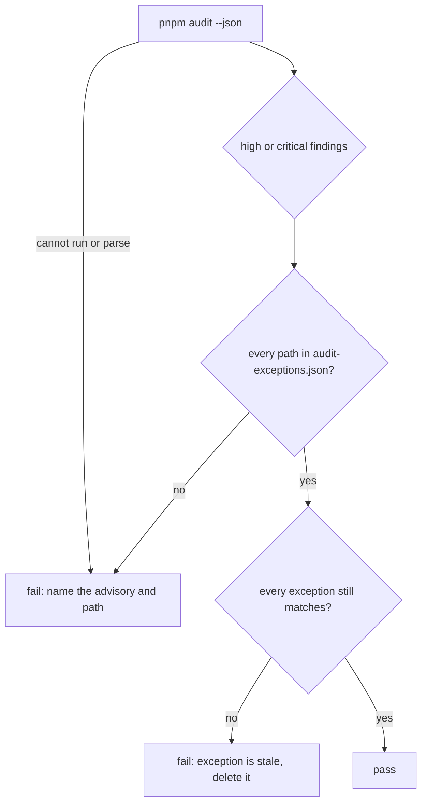

# ADR: Scoped audit exceptions

- **Status:** Accepted (2026-10-26)
- **Amended by:** `ADR-2026-10-26-audit-exceptions-by-dependent.md` (decisions 2 to 4)
- **Date:** 2026-10-26
- **Scope:** CI `dependency audit` job, root `package.json` (`pnpm.overrides`,
  `pnpm.auditConfig`), `apps/docs/package.json`, a new `scripts/audit.mjs` and
  `audit-exceptions.json`. No published package changes.

## Context

CI runs `pnpm audit --audit-level=high` and fails on any high or critical advisory.
Main has been red since `0fa1fd7` (#173) because of GHSA-mrhx-c7xc-m3w5, published
2026-10-01: zod before 4.6.6 builds one issue object per failing array element with no
cap, so a large enough array exhausts memory. Every open PR fails with it, including
#176.

The lockfile has four paths to an affected zod. pnpm reports one path per version,
so the fourth only appeared once the `fumadocs-docgen` path was gone:

| Path                                                                                 | zod     | Fix                                                        |
| ------------------------------------------------------------------------------------ | ------- | ---------------------------------------------------------- |
| `apps/docs > fumadocs-docgen@2.1.0`                                                  | 3.25.76 | `fumadocs-docgen` is declared but never imported           |
| `apps/docs > fumadocs-mdx@13.0.8`                                                    | 4.4.1   | its range is `^4.1.12`, so 4.6.7 satisfies it              |
| `packages/react > wagmi > @wagmi/connectors > … > @reown/appkit > @reown/appkit-wallet` | 3.22.4  | none: the latest `appkit-wallet` (1.8.24) still pins 3.22.4 |
| `packages/react > wagmi > @wagmi/connectors > @base-org/account > @coinbase/cdp-sdk` | 3.25.76 | none: the latest `cdp-sdk` (1.60.0) still needs zod 3 |

Today's escape hatch is `pnpm.auditConfig.ignoreGhsas`, which ignores an advisory
everywhere, forever. The two entries in it show the problem:

- `GHSA-vfj7-8cjw-p6xm` no longer matches anything. Nobody noticed it went stale.
- `GHSA-3gc7-fjrx-p6mg` (bigint-buffer, no fixed release) is reached only through
  `@solana/spl-token`, but the ignore would equally hide it if it reached
  `@usewhisk/core` some other way.

Ignoring GHSA-mrhx-c7xc-m3w5 the same way would hide zod in Whisk's own packages
too, where it would matter.

## Decision

1. **Fix what can be fixed.**
   - Remove the unused `fumadocs-docgen` from `apps/docs`.
   - Add the override `"zod@>=4.0.0 <4.6.6": "^4.6.7"`, in the style of the existing
     overrides. It stays inside zod 4's semver range, so no consumer's API changes,
     and it stops a stale lockfile or a new dependency from bringing back a
     vulnerable zod 4.

2. **Scoped exceptions instead of `ignoreGhsas`.** `auditConfig.ignoreGhsas` is
   removed. `audit-exceptions.json` lists each accepted finding by advisory,
   package, exact version and exact dependency path, with a written reason:

   ```json
   {
     "ghsa": "GHSA-mrhx-c7xc-m3w5",
     "package": "zod",
     "version": "3.22.4",
     "path": "packages__react>wagmi>@wagmi/connectors>@walletconnect/ethereum-provider>@reown/appkit>@reown/appkit-wallet>zod",
     "reason": "..."
   }
   ```

3. **`scripts/audit.mjs` is the gate.** It runs `pnpm audit --json` and fails when:
   - a high or critical finding has a path no exception covers. The same
     advisory reaching a Whisk package by a new route fails;
   - an exception matches nothing. When upstream fixes or moves its dependency, the
     exception goes stale and CI says to delete it, so the list never rots;
   - the audit itself cannot run or returns something it cannot read. It never
     passes by default.

   CI runs `node scripts/audit.mjs` in place of `pnpm audit --audit-level=high`.
   Moderate and low advisories stay with Dependabot, as now.

4. **Initial exceptions.** Only the three findings with no fixed release:
   - zod 3.22.4 under `@reown/appkit-wallet`: appkit-wallet parses `postMessage`
     events for its embedded email and social wallet frame with zod. That frame is
     not started by the WalletConnect connector Whisk's wallets use, and a page
     that can post such a message can already run script in the payer's tab, so
     the worst case is that script crashing its own tab.
   - bigint-buffer 1.1.5 under `@solana/spl-token`: Whisk imports only
     `getAssociatedTokenAddressSync` and `TOKEN_PROGRAM_ID`, and never decodes token
     account data, which is where `toBigIntLE` runs.
   - zod 3.25.76 under `@coinbase/cdp-sdk`: `@base-org/account` loads it only in
     `charge` and `getOrCreateSubscriptionOwnerWallet`, exported from its Node entry
     alone and needing Coinbase CDP API keys. Whisk never imports
     `@base-org/account` and does not configure wagmi's `baseAccount` connector.

## Diagram



## Consequences

- CI is green again, and stays honest: an accepted risk covers one path at one
  version, not a whole advisory.
- When WalletConnect ships a fixed zod, or a dependency bump moves the version, CI
  fails on that PR until the exception is deleted or re-reviewed. That is a
  one-line change, and it is the point.
- Accepting a new exception is a reviewed change to `audit-exceptions.json`, with
  its reason in the diff.
- One small script to maintain, with tests.

## Alternatives considered

- **Add the advisory to `ignoreGhsas`.** Fastest, but hides it in Whisk's packages
  too and never expires. Rejected.
- **Force zod 4 everywhere.** `appkit-wallet` is written against zod 3.22; a major
  override could break wallet connection at runtime with no test to catch it.
  Rejected.
- **Upgrade `fumadocs-mdx` to 15.** Also fixes its path, but two majors with new
  peers for a range bump the override already gives. Left for a docs upgrade.
- **Drop WalletConnect from the React package.** Removes the path, but takes away a
  wallet payers use. Rejected.

## Verification

- Unit tests for the gate: uncovered finding fails, covered finding passes, stale
  exception fails, moderate findings ignored, unreadable audit output fails.
- `node scripts/audit.mjs` passes on the branch and fails with GHSA-mrhx-c7xc-m3w5
  against main's lockfile.
- `pnpm why zod` shows no zod 4 below 4.6.6; the docs app builds.
- `./scripts/preflight.sh` passes.
